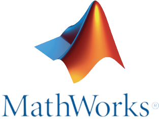

<h1 align="center">Multi-Robot Warehouse Simulation<br>Full Project Documentation</h1>

<br clear="all">

<div align="center">

[](https://www.mathworks.com/products/matlab.html) [](https://www.mathworks.com/products/3d-animation.html) [](https://www.unrealengine.com/) [](https://www.mathworks.com/products/stateflow.html) [](LICENSE)

</div>

**MATLAB and Simulink Challenge Project 212: Warehouse Robotics Simulation**

This document describes my complete solution in detail, with the method, the model, the equations, the results and every picture and animation of the project. The shorter [README.md](README.md) explains how to install and run it.

## Contents

1. [Overview](#1-overview)
2. [Problem and solution](#2-problem-and-solution)
3. [Methodology](#3-methodology)
4. [System architecture](#4-system-architecture)
5. [Simulink and Stateflow model](#5-simulink-and-stateflow-model)
6. [Mathematical model](#6-mathematical-model)
7. [Results and output](#7-results-and-output)
8. [Requirements](#8-requirements)
9. [How to run](#9-how-to-run)
10. [Design decisions and performance](#10-design-decisions-and-performance)
11. [Use of generative AI](#11-use-of-generative-ai)
12. [Repository structure](#12-repository-structure)
13. [Project video](#13-project-video)
14. [Project timeline](#14-project-timeline)
15. [Credits](#15-credits)
16. [License](#16-license)

---

## 1. Overview

Many warehouses move boxes between a receiving area, the shelves and the packing stations. When several robots share the same narrow aisles, they block each other, reach into the same shelf bay or even collide. I wanted to study this coordination problem in simulation before any real robot is put at risk.

I developed the project in three phases. Phase 1 is the 3-D warehouse. Phase 2 adds one robot that drives to a shelf, docks and grasps a box with a Kinova Gen3 arm. Phase 3 puts six of these robots into the warehouse and adds the fleet manager, the multi-robot planner, the sensing layer and the fault recovery.

Each robot has a differential-drive base, a vertical lift, a seven-joint arm, a camera and a lidar. A Stateflow chart sequences every task, a MATLAB controller drives the base and the arm, and Simulink 3D Animation shows everything in an Unreal Engine scene.

The user works with three modes. Manual and Batch mode let me give jobs by typing short commands, and Auto mode creates the jobs by itself. After every run the program writes a summary with throughput, utilization, energy and the safety figures.

---

## 2. Problem and solution

### 2.1 Problem

1. E-commerce keeps growing, and customers expect fast delivery. To meet this, warehouses use robots that automate the storage and the retrieval of goods. Simulation is the key to test such scenarios before anything real is built: it shows which algorithms suit the task and what the warehouse design and the robots must be like.

2. This project builds such a simulation as one complete platform. Six mobile manipulators work in a 3-D warehouse, and a fleet manager, a multi-robot planner, a sensing layer and an evaluation of every run are included, so a user can test fleet size, layout and algorithms without risking a real robot.

Such a platform has to solve four technical problems at the same time:

- **Task allocation.** Many tasks arrive at different times. Each task must go to a suitable robot, so that no robot waits idle while another one is overloaded.
- **Shared aisles.** The aisles are narrow, and a robot with a box and an arm needs more room than its chassis. Robots can meet head-on, cross each other's routes or block each other.
- **Shared resources.** Two arms must not reach into the same shelf bay, and two robots must not use the same place of a packing table.
- **Imperfect knowledge.** A robot knows its own position only approximately, but a grasp needs centimetre accuracy.

### 2.2 Solution

1. The fleet manager `Phase3Fleet` keeps a task queue and a database of 554 slots and 54 boxes. The nearest free robot takes the next task, and an urgent job moves to the front of the queue.
2. Each robot plans its own shortest route with A\*. When the routes of some robots collide, M\* searches only these robots together, so the planning effort stays small.
3. A shelf bay and a station place belong to one robot at a time. The other robots wait with an empty gripper at a safe distance and start as soon as the place is free.
4. Wheel odometry and AMCL give the pose. During the arm motion the robot works relative to the box and the shelf that its camera and lidar measure at close range, so a small localization error does not spoil the grasp.
5. Right of way, a speed layer, a safety bubble and a watchdog are designed to prevent collisions between the robots. They protect the robots in this order, and each layer works on its own.
6. A robot that fails a task folds its arm, gets a new slot or returns the task to the queue, and goes on working.
7. Everything is built as one reusable platform. The Simulink model, the Stateflow task chart and the Unreal Engine scene can be run again with another number of tasks, another task mix or another operating mode.
8. Every run writes its own evaluation metrics (throughput, utilization, energy, minimum robot distance, near misses, collisions and camera checks), so different set-ups can be compared with numbers.

---

## 3. Methodology

I followed the same sequence of steps for every task. The picture shows it from the user command to the log entry, including the path that a fault takes.

**Task flow of one job**

<p align="center">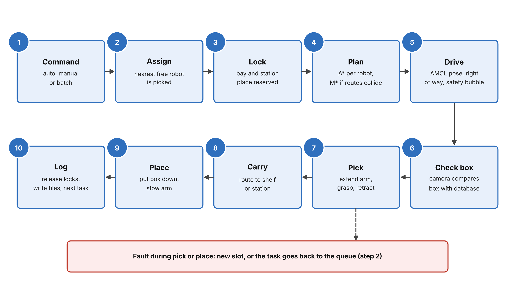</p>

- The ten steps run from the user command to the log entry. The fleet manager does steps 1 to 4, the robot controller does steps 5 to 9, and the sensing layer supports steps 5 and 6.
- A fault during the pick or the place sends the task back to the fleet manager with a new slot or into the queue.
- Source: Diagram drawn for this project from the task logic of `Phase3Fleet` and the Stateflow chart.


I tested each phase before I started the next one. The Phase 2 controller `WarehouseRobotControlSystemV23` runs without any change in every robot of Phase 3, and this saved a lot of debugging time. The following parts describe how I built each phase.

### 3.1 Phases

Phase 1 builds the warehouse without robots. I used it to check the geometry, the slot names and the 3-D scene. Phase 2 adds one robot with a lift and an arm, and here I developed navigation, docking, grasping and the task sequence. Phase 3 multiplies the robot to six and adds the fleet manager, M\*, the sensing layer and the fault recovery.

The console pictures show how each phase starts in MATLAB.

**Starting Phase 1**

<p align="center">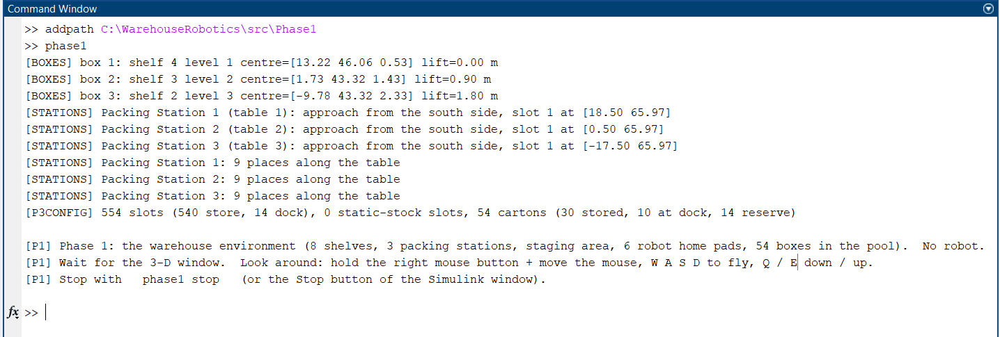</p>

- The commands `cd`, `addpath`, and `phase1` open the empty warehouse.
- Source: MATLAB Command Window.


**Starting Phase 2**

<p align="center">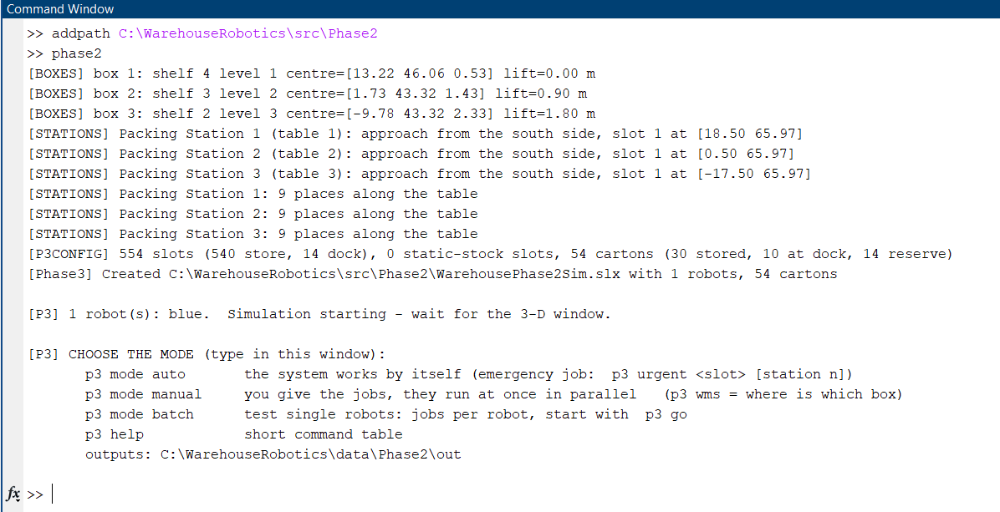</p>

- The commands start the one-robot mission.
- Source: MATLAB Command Window.


**Starting Phase 3**

<p align="center">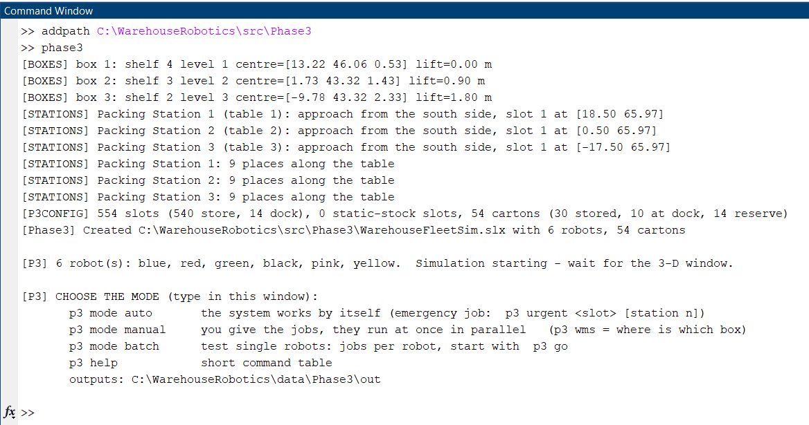</p>

- The command `phase3` opens the 3-D window and the 2-D map and waits for a mode.
- Source: MATLAB Command Window.


The folder structure of the source code follows the three phases.

**Source folder structure**

<p align="center">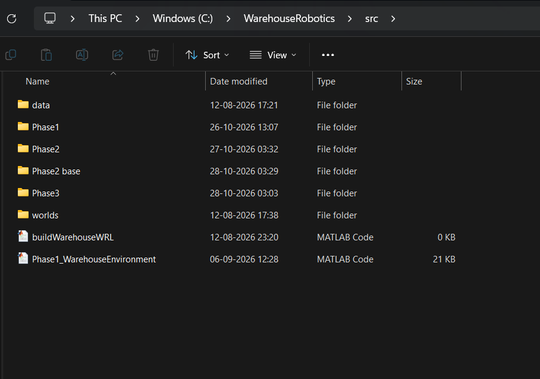</p>

- The folders `Phase1`, `Phase2`, and `Phase3` hold the code of the three stages.
- Source: Windows file explorer.


### 3.2 The warehouse environment

The floor measures 58 m by 75 m. It has eight shelves, and shelves 1 and 8 are the long ones. Three packing stations stand in the north. The staging area has three mats with 14 stands, D01 to D14, and each of the six robots has its own home pad. The demonstration set holds 54 boxes.

Every shelf has two faces, A on the west side and B on the east side, and three levels, L1 to L3. A slot name has the form `<shelf><face>-L<level>-P<position>`. For example, `3B-L2-P05` means shelf 3, east face, middle level, position 5. A packing station has as many places as its table is long, which is nine places, and it ships its boxes only when all places are full.

The top-down view shows the complete layout.

**Top-down view of the complete layout**

<p align="center">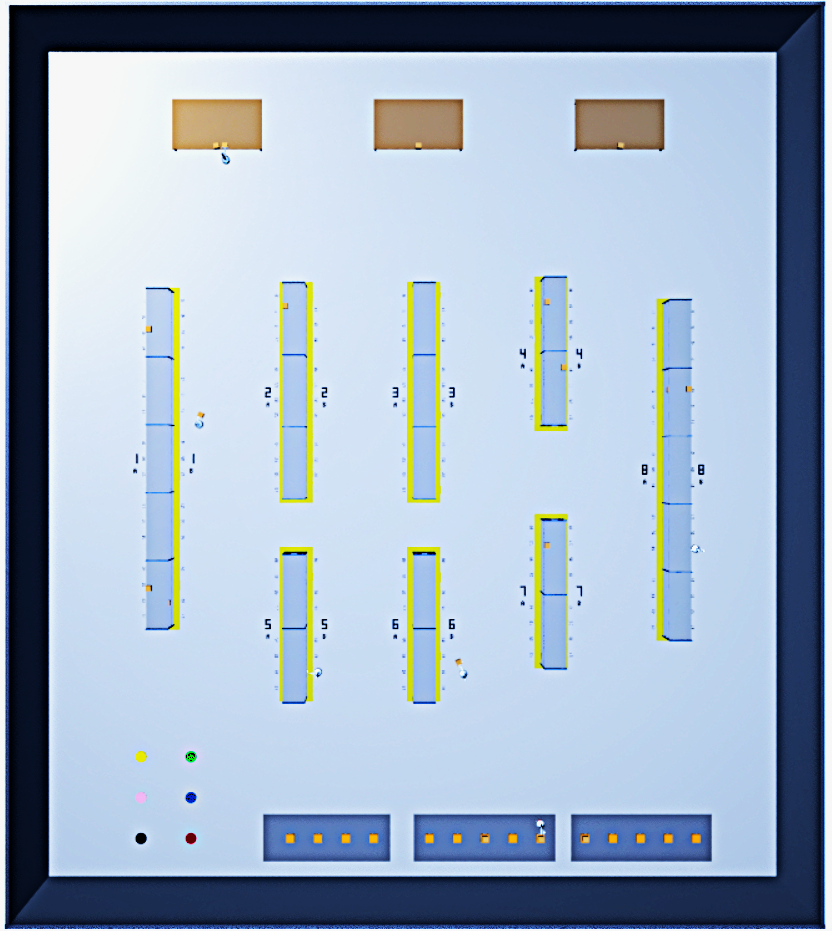</p>

- The floor measures 58 m by 75 m. It contains 8 shelves, 3 packing stations in the north, a staging area, and 6 home pads.
- Source: Simulation 3D Viewer, top-down camera.


The next view shows the packing stations in the north and the shelf rows.

**Packing stations and shelves from above**

<p align="center">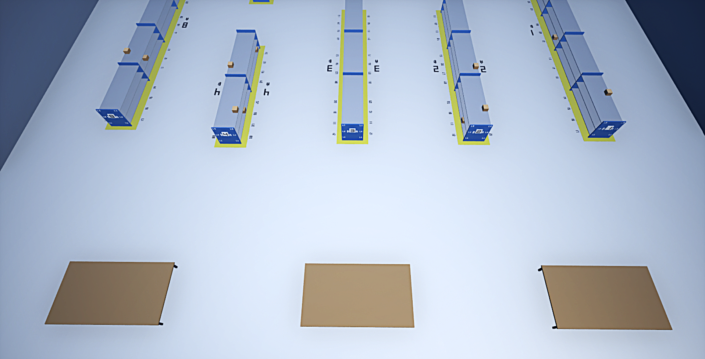</p>

- The three packing stations are located in the north. The shelves stand in parallel rows with aisles between them.
- Source: Simulation 3D Viewer, top-down camera.


The staging area and the home pads are in the south.

**Home pads and staging stands**

<p align="center">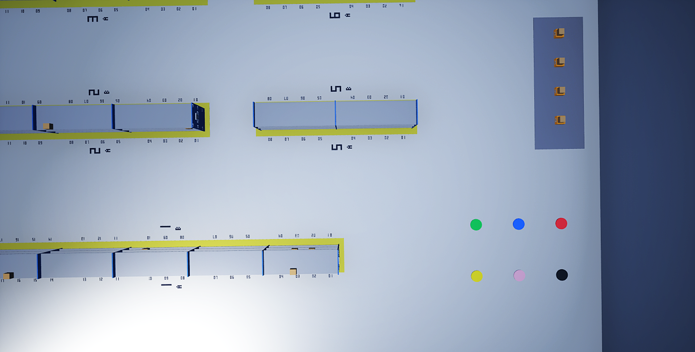</p>

- Each robot has its own home pad. The staging area holds 14 stands with boxes that wait for put-away.
- Source: Simulation 3D Viewer, top-down camera.


Each shelf end carries a plate with the shelf number, the faces and the levels. This way I can read the slot names directly in the 3-D window.

**Shelf end panel**

<p align="center">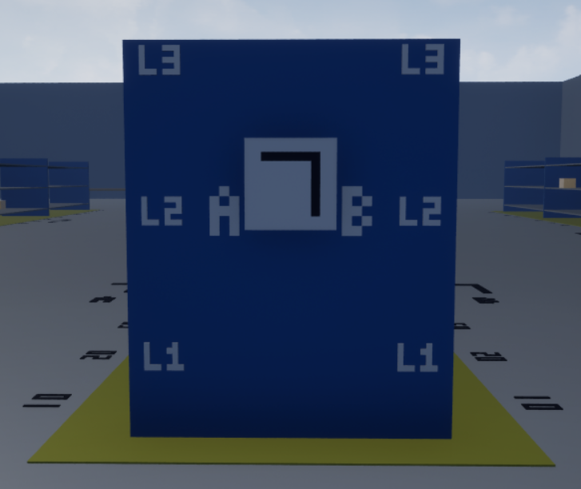</p>

- The plate names the shelf number, the two faces A and B, and the levels L1 to L3. Slot names follow the pattern `<shelf><face>-L<level>-P<position>`, for example `3B-L2-P05`.
- Source: Simulation 3D Viewer.


The overview shows the warehouse during a run.

**Overview of the warehouse with working robots**

<p align="center">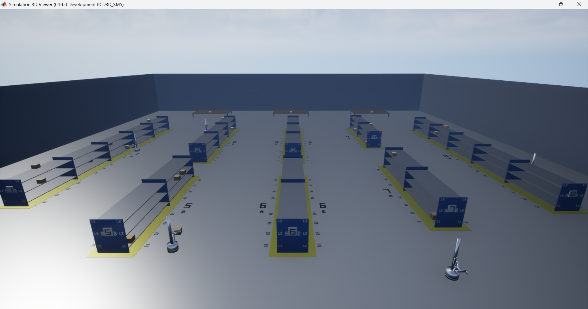</p>

- Several robots are located at shelves and stations during a run.
- Source: Simulation 3D Viewer.


The free-fly camera shows the aisles from the viewpoint of a person who walks through the warehouse.

**Fly-through along a shelf aisle**

<p align="center">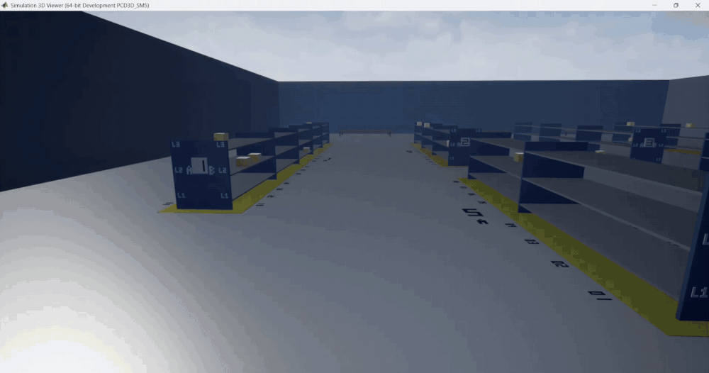</p>

- The free camera moves along an aisle and shows the shelf levels, the floor labels, and the boxes.
- Source: Simulation 3D Viewer with the free-fly camera.


### 3.3 The robot

Each robot has a differential-drive base with a circular safety radius, a vertical lift column that moves the arm to the three shelf levels, a seven-joint Kinova Gen3 arm with a clamp gripper, a camera on the lift carriage and a lidar on the base. The robot model is a `rigidBodyTree`. The function `helperBuildMobileManipulator.m` builds it from `loadrobot('kinovaGen3')` and the lift.

<div align="center">
<table>
<tr><td align="center">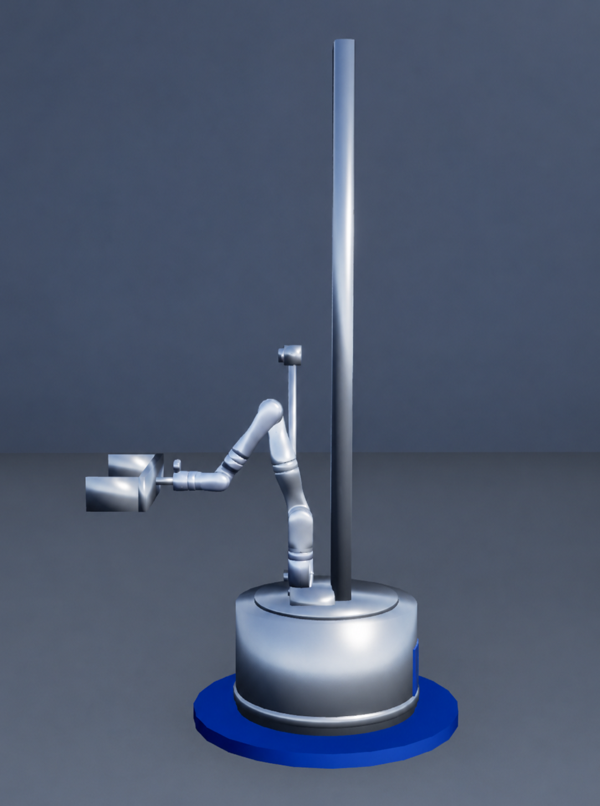</td><td align="center">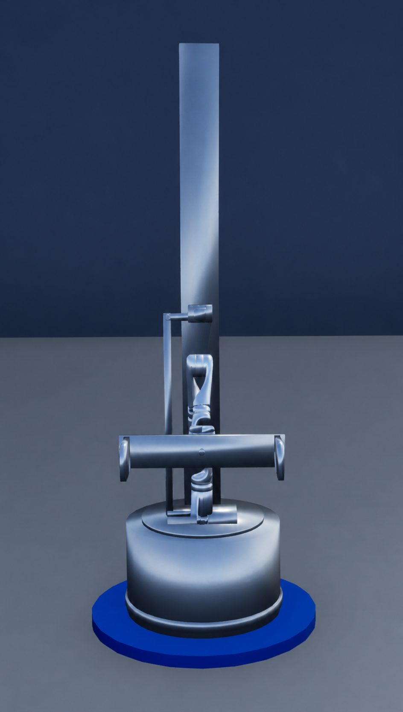</td><td align="center">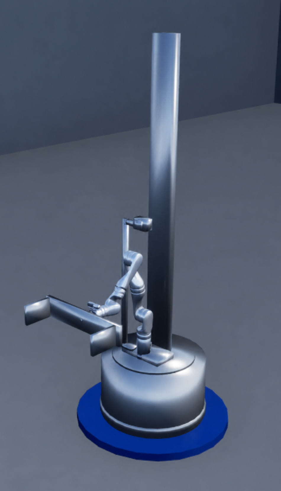</td></tr>
<tr><td align="center" valign="top"><b>Side view</b></td><td align="center" valign="top"><b>Front view</b></td><td align="center" valign="top"><b>Three-quarter view</b></td></tr>
</table>
</div>

*Source: Unreal Engine renderings of the robot in the 3-D viewer.*


The next two pictures show the arm at work.

**Arm at shelf level 3, close-up**

<p align="center">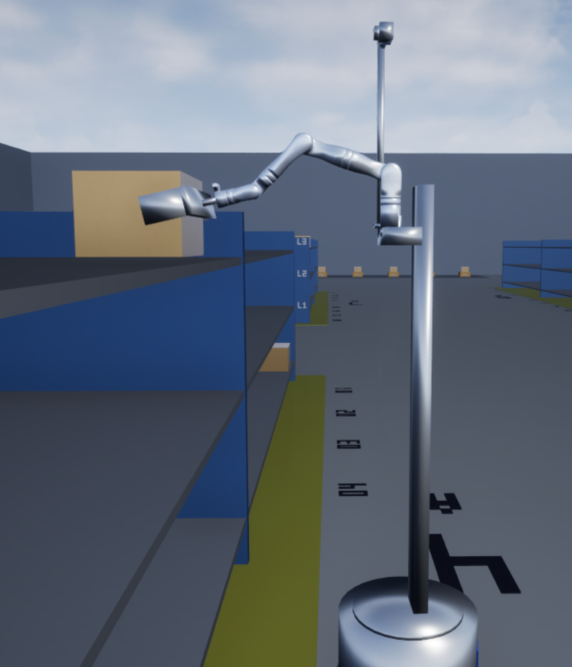</p>

- The lift carriage is at the top level and the gripper approaches the box.
- Source: Simulation 3D Viewer.


**Robot picking a box at the staging stands**

<p align="center">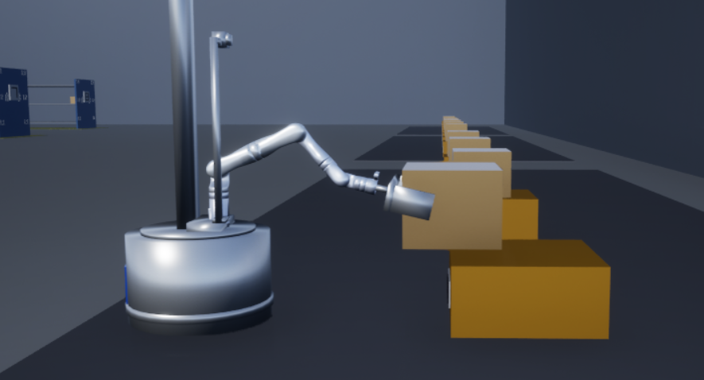</p>

- The staging stands hold the arriving boxes. The robot takes one box and carries it to a shelf slot.
- Source: Simulation 3D Viewer.


The following animations show the typical work steps of a robot.

**Robot at a shelf**

<p align="center">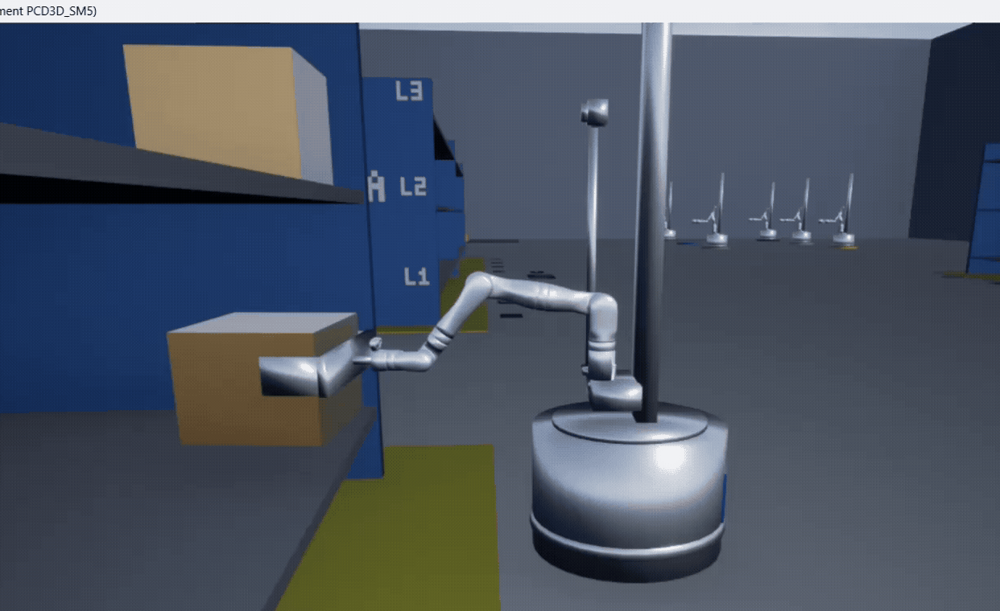</p>

- The robot stops in front of the target slot, extends the arm, and takes the box from the shelf.
- Source: Simulation 3D Viewer, Phase 3.


**Arm working at shelf level 3**

<p align="center">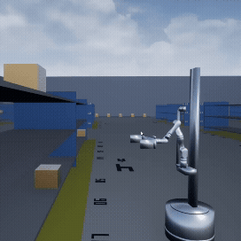</p>

- The lift raises the arm to the top level. The arm then approaches the box and grasps it.
- Source: Simulation 3D Viewer, close view of one robot.


**Robot beside a shelf with a magenta box**

<p align="center">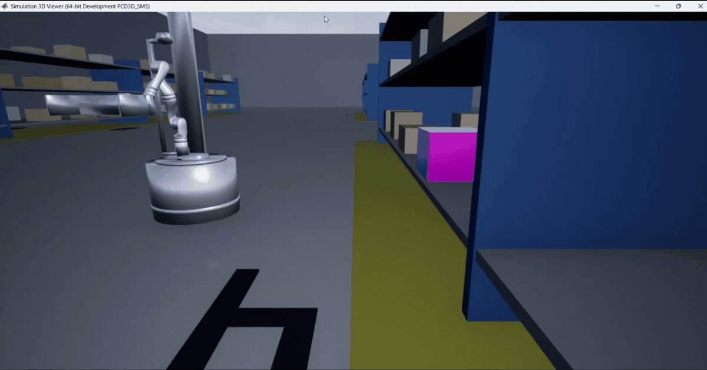</p>

- The animation shows the robot docking next to a shelf that holds a magenta box.
- Source: Simulation 3D Viewer, Phase 3.


**Robot at a packing table**

<p align="center">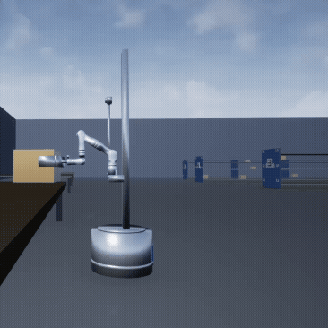</p>

- A robot carries a box to a packing station and places it on a free place of the table.
- Source: Simulation 3D Viewer, Phase 3.


Two robots can work on the same long shelf at the same time. The fleet manager gives each robot its own bay.

**Two robots working at shelf 1**

<p align="center">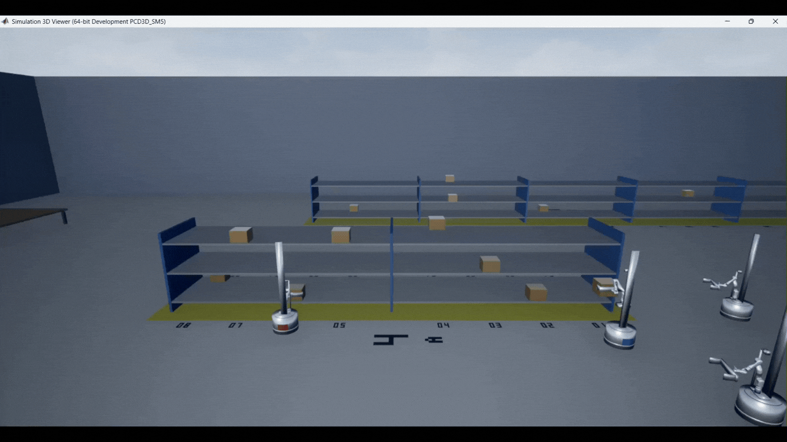</p>

- Two robots work on the long shelf 1 at the same time and keep the required distance between their bays.
- The fleet manager reserves a bay for each robot, so two arms never reach into the same bay.
- Source: Simulation 3D Viewer, Phase 3 (22 MB).


### 3.4 Fleet management and multi-robot planning

**Task scheduling.** The fleet manager creates put-away tasks for boxes at the staging stands and retrieve tasks for boxes on the shelves. The nearest suitable free robot takes the next task. An urgent job (`p3 urgent`) has the highest priority.

**Zone locks.** A shelf bay (the slot and its neighbours on both faces) and a packing-station place belong to one robot from the assignment until the robot has left. A robot whose task is blocked by a lock waits with an empty gripper at a safe distance and starts as soon as the lock is free. The number of robots per shelf block is limited. For example, four robots can work at the same time on shelves 4 to 7 and ten on the long shelves 1 and 8. In this way two arms never work in the same bay.

**M\* planning.** Each robot plans its shortest route with A\* on the inflated occupancy map. The module `fleetMStar.m` then applies M\* (Wagner and Choset). Robots whose routes do not interfere keep their own routes. Robots whose routes collide form a collision set, and I search this set together on a 0.5 m grid. The search is limited to three robots, 6000 nodes and 2.5 s. When a limit is reached, the planner changes nothing, and the speed layer handles the situation. The earlier prioritized planner is still available with `phase3 planner prioritised`.

**Fault recovery.** A failed task does not stop a robot for good. A robot without a box folds its arm, drives home and returns the task to the queue. A robot with a box gets a new free slot or station place, and the failed slot is blocked.

### 3.5 Collision avoidance

Several layers protect the robots, and every layer works independently of the others.

1. **Locks and capacity rules** keep the robots at different bays and places.
2. **Route negotiation in space and time** compares the committed routes of all robots. A robot plans an alternative route only when a real simultaneous crossing occurs.
3. **Right of way.** A robot that works at a rack keeps its place. A robot that carries a box keeps its path, and the empty robot gives way. Between equal robots, one yields in a fixed order.
4. **Safety bubble.** Whatever the plan says, a robot never drives towards another robot inside the distances of section 6.4. The check includes the carried box and the arm.
5. **Face-to-face pull-over.** When two robots meet head-on, one of them pulls over to make room.
6. **Watchdog.** A robot that makes no progress for too long receives a recovery action.

### 3.6 Sensing, localization and camera

Each robot integrates wheel odometry, and `monteCarloLocalization` of the Navigation Toolbox corrects the estimate with the lidar scan. In the default `perf light` mode the lidar is a ray-cast of the occupancy map, and in the `perf full` mode it is the Unreal Engine lidar. The gate and the reset of section 6.2 keep the estimate close to the real pose. The reset uses the simulator pose as a reference, and a real robot would need a global localization routine instead.

A `multiObjectTracker` of the Automated Driving Toolbox joins lidar clusters and fleet broadcasts into tracks, and a protective field around each robot uses these tracks.

The camera on the lift carriage looks at the slot before each grasp. The functions `p3CamLocate.m` and `p3CamCVT.m` use `cameraIntrinsics`, `world2img` and `vision.BlobAnalysis` of the Computer Vision Toolbox for colour segmentation and silhouette matching. The result is compared with the database slot, and a difference above 35 cm fails the check. Each run reports the passed and the failed checks.

**Camera detection overlay**

<p align="center">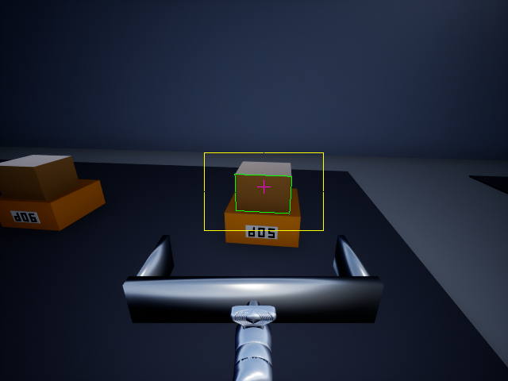</p>

- The overlay marks the box that the detector found in the camera image.
- The detector segments the carton colour, matches the silhouette of the known box size, and compares the result with the database slot. A difference above 35 cm fails the check.
- Source: Robot camera window.


**Camera view while grasping at slot 4A-L1-P01**

<p align="center">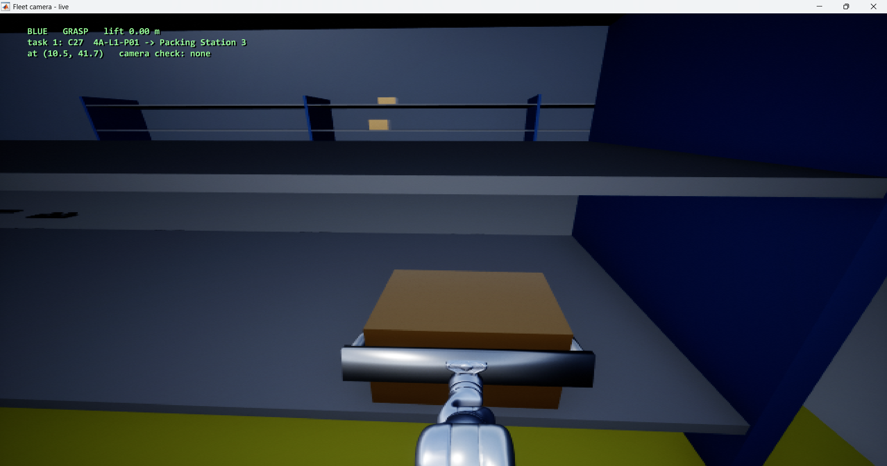</p>

- The blue robot checks the box before the grasp.
- Source: Camera image saved to `data\Phase3\out\Camera`.


**Camera view at level 3**

<p align="center">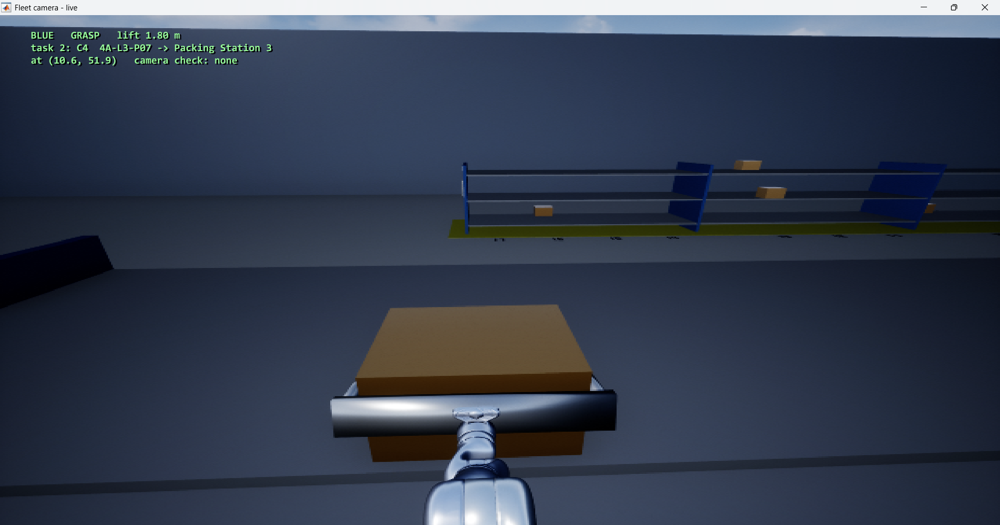</p>

- The lift stands at 1.80 m, and the camera sees the top shelf level.
- Source: Camera image saved to `data\Phase3\out\Camera`.


**Camera view while carrying box C37**

<p align="center">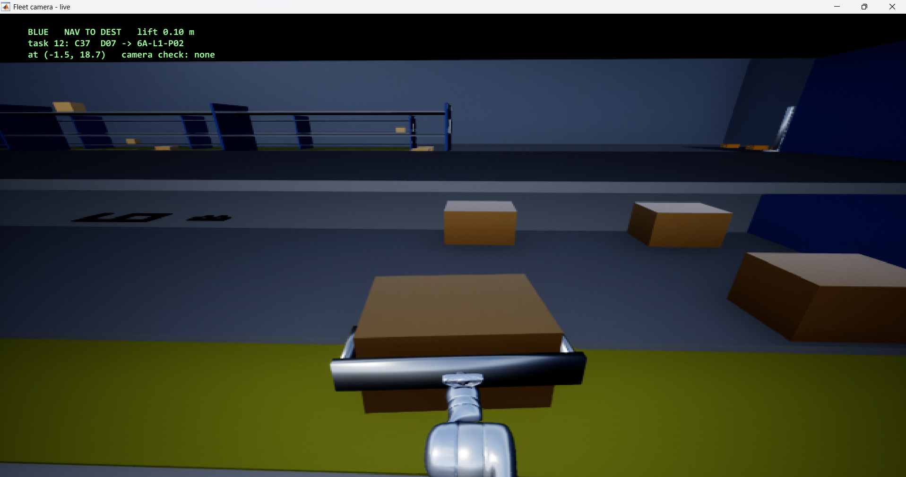</p>

- The blue robot drives to its destination. The carried box is visible in front of the camera.
- Source: Camera image saved to `data\Phase3\out\Camera`.


**Camera view at Packing Station 3 while stowing the arm**

<p align="center">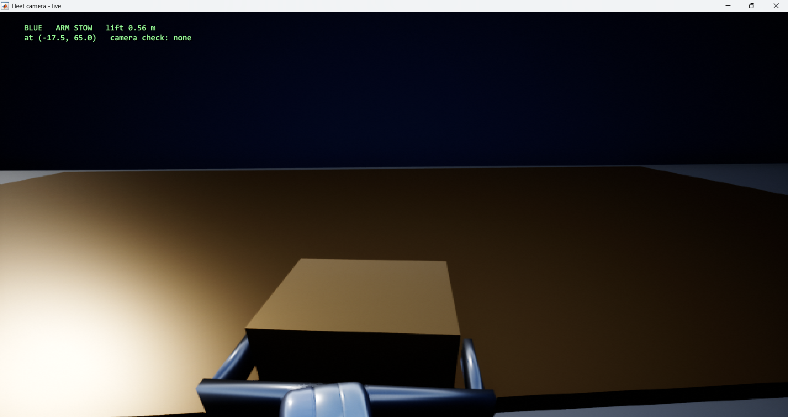</p>

- The robot has placed the box and folds the arm back into its travel pose.
- Source: Camera image saved to `data\Phase3\out\Camera`.


### 3.7 Arm control

The arm uses `inverseKinematics` of the Robotics System Toolbox (section 6.6). The controller samples Cartesian paths for approach, grasp, retraction and placement, and it checks each path for collisions with the shelf and the box. When the exact place centre is out of reach, the controller tries up to 15 small shifts of the put-down point before it reports a fault. The arm phases plan in the local frame of the robot, so the small localization errors of the base do not spoil the grasp.

---

## 4. System architecture

The fleet manager sits in the centre. It receives my commands, sends tasks to the six robot controllers and writes the live map and the log files. Each controller exchanges routes with the multi-robot planner and poses with its sensing block. The controllers send joint and base commands to the Simulink model, and the Unreal Engine scene returns the lidar scans and camera images.

**System architecture**

<p align="center">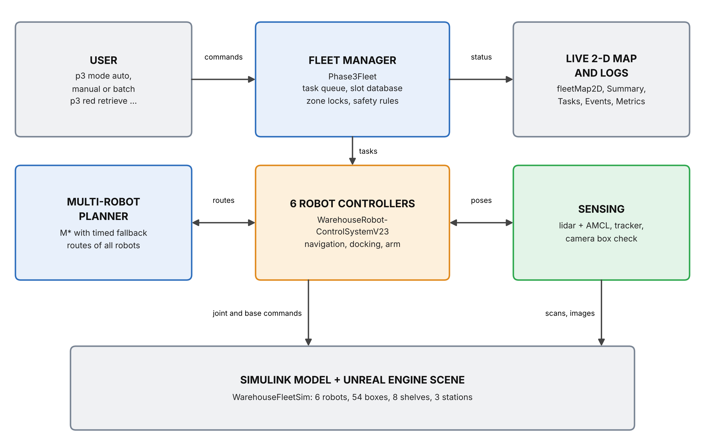</p>

- The fleet manager receives the commands, sends tasks to the six controllers and writes the live map and the log files.
- Each controller exchanges routes with the multi-robot planner and poses with its sensing block, and it sends joint and base commands to the Simulink model.
- The Unreal Engine scene returns the lidar scans and the camera images.
- Source: Diagram drawn for this project from the structure of the project code.


The next diagram is the more detailed version of the same architecture. It also names the functions and the toolboxes that each block uses.

**Phase 3 architecture: who talks to whom**

<p align="center">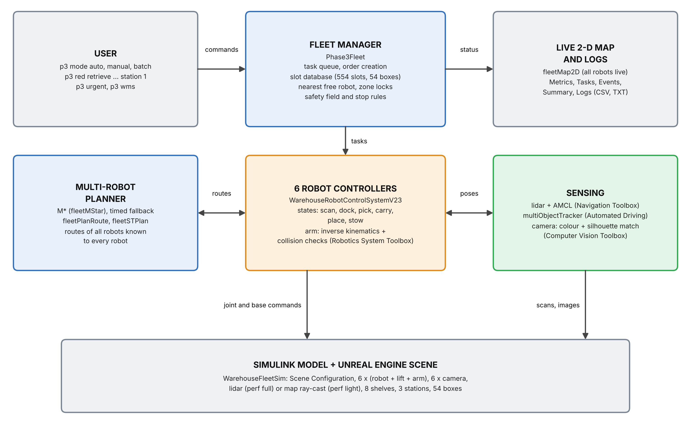</p>

- The fleet manager receives your commands, keeps the task queue and the slot database (554 slots, 54 boxes), assigns the nearest free robot, and applies the zone locks and the stop rules. It sends status to the live 2-D map and writes the log files.
- The multi-robot planner (M\* with a timed fallback) exchanges routes with the six robot controllers, so every robot knows the routes of all other robots.
- The sensing block returns poses to the controller, using lidar with AMCL, the multi-object tracker, and the camera.
- The controller sends joint and base commands to the Simulink model and the Unreal Engine scene, and the scene returns scans and images.
- Source: Diagram drawn from the structure of the project code.


---

## 5. Simulink and Stateflow model

The Simulink model contains the robots, the sensors and the Unreal Engine blocks, and the Stateflow chart sequences each task. I start with the complete overview and then show the three parts of it in larger detail.

**Top level of `WarehouseFleetSim.slx` (347 blocks, 78 subsystems)**

<p align="center"></p>

- This diagram is the map of the whole Phase 3 model. The model has three repeating parts: the fleet level, six robot channels (blue, red, green, black, pink, yellow), and a pool of 54 box actors.
- The fleet level contains one MATLAB System block, `Fleet Carton Cmd`, which runs the fleet manager `Phase3FleetBlock` with the task queue, the M\* planner, the slots, the zone locks, and the metrics. It also contains the stop block and the live fleet camera window.
- Each robot channel contains the sensing block `Robot Sense` (lidar, wheel odometry, AMCL, tracker), the robot subsystem itself, a camera on the lift carriage (640 x 480 pixels), the camera detector `Camera Detect`, and the helper blocks that paint a coloured mark on the chassis.
- The carton pool contains the carton router, which converts the carried-box states of the six robots into a position, a rotation, and a drive flag for each of the 54 boxes. One enabled subsystem per box then moves the box in the Unreal Engine scene, and the Transform Get blocks read the poses back through a unit delay that breaks the algebraic loop.
- The two orange blocks at the top, `Scene Configuration` and `Phase3 Warehouse`, create the Unreal Engine scene with the shelves, stations, staging stands, floor marks, and home pads.
- Source: Diagram drawn from the block names and connections in the model file.


**Fleet level and fleet camera**

<p align="center">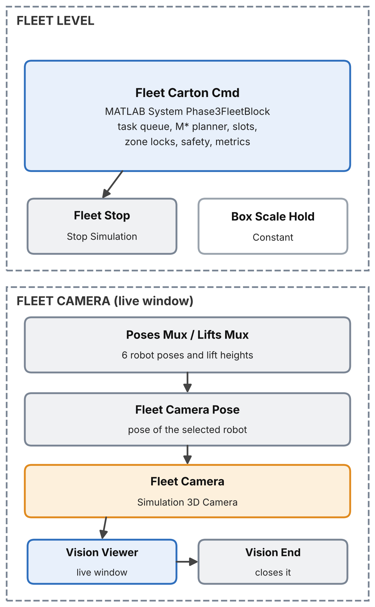</p>

- The block `Fleet Carton Cmd` is a MATLAB System block that runs the fleet manager with the task queue, the M\* planner, the slots, the zone locks, the safety rules and the metrics.
- `Fleet Stop` ends the simulation. The fleet camera chain (`Poses Mux`, `Fleet Camera Pose`, `Fleet Camera`, `Vision Viewer`) shows one selected robot in a live window.
- Source: Detail of the overview of `WarehouseFleetSim.slx`.


**One robot channel**

<p align="center">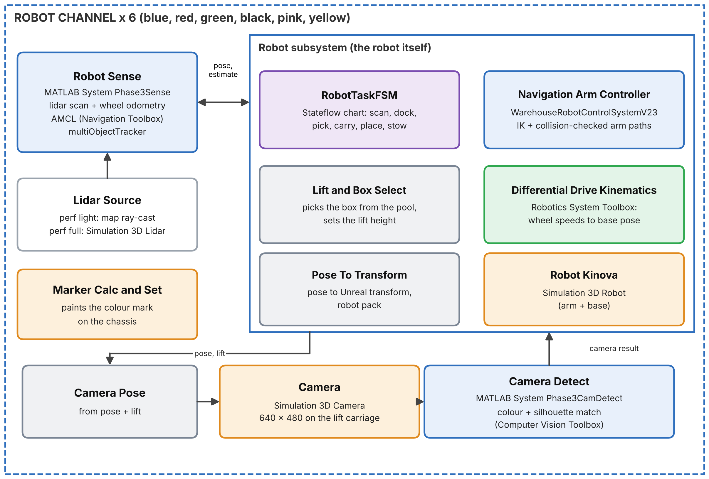</p>

- `Robot Sense` runs lidar, wheel odometry, AMCL and the tracker. In `perf light` mode the lidar input is a constant and the scan comes from the map ray-cast, and in `perf full` mode it is the Simulation 3D Lidar block.
- The subsystem `Robot subsystem` holds the Stateflow chart, the navigation and arm controller, the drive kinematics and the Kinova robot block.
- Below the subsystem, `Camera` takes the image on the lift carriage and `Camera Detect` finds the box by colour and silhouette. The marker blocks paint a coloured mark on the chassis.
- Source: Detail of the overview of `WarehouseFleetSim.slx`.


**The carton pool**

<p align="center">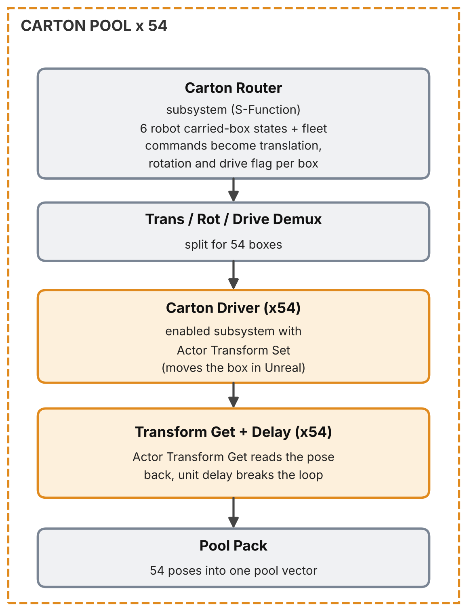</p>

- The carton router converts the carried-box states of the six robots into a position, a rotation and a drive flag for each of the 54 boxes.
- Each `Carton Driver` is an enabled subsystem with a Simulation 3D Actor Transform Set block, so a box moves only while a robot carries it. A Transform Get block and a unit delay read the pose back, and `Pool Pack` joins all poses into one vector.
- Source: Detail of the overview of `WarehouseFleetSim.slx`.


Inside one robot subsystem, the Stateflow chart, the controller, the drive kinematics and the robot block are wired together as follows.

**Inside one robot subsystem**

<p align="center">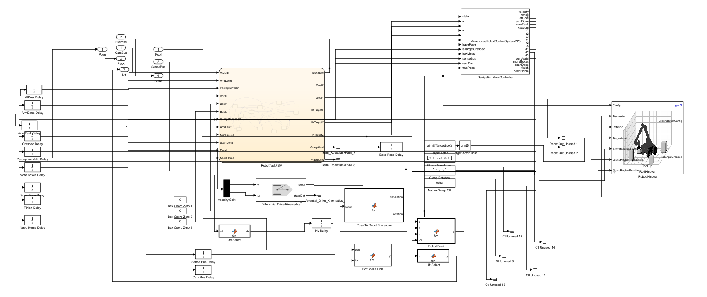</p>

- The picture shows the real wiring of one robot. The inputs on the left are the pose, the estimated pose, the pool of box poses, the sense bus, the camera bus, the pack, the lift, and the state.
- The Stateflow chart `RobotTaskFSM` receives the status flags (at goal, arm done, arm fault, perception valid, more boxes, scan done, finish, need home) and returns the task state, the goal position, and the target of the inverse kinematics.
- The controller `WarehouseRobotControlSystemV23` (the large block at the top) turns the task state into a base velocity, the arm joint configuration, and the grasp and place commands.
- The velocity passes through `Velocity Split` into `Differential Drive Kinematics`, which integrates the base pose. `Pose To Robot Transform` converts the pose into an Unreal Engine transform, and the block `Robot Kinova` displays the base and the arm.
- The many `1/z` blocks are unit delays. They separate the algebraic loops between the controller, the chart, and the scene, so that every signal has a defined value at each time step.
- Source: Simulink model `WarehouseFleetSim.slx`.


**Stateflow chart `RobotTaskFSM`**

<p align="center"></p>

- The chart has 13 states. Each state sets the task state number, the goal position, and the grasp and place commands on entry.
- The normal cycle is `IDLE`, `NAV_TO_STAGING` (state 1), `DOCK_SHELF` (10), `ARM_EXTEND` (2), `GRASP` (3), `ARM_RETRACT` (4), `NAV_TO_TABLE` (5), `ARM_PLACE` (6), `RELEASE` (8), `ARM_STOW` (9), and `RETURN_HOME` (7).
- The transitions depend on the flags `AtGoal`, `ScanDone`, `PerceptionValid`, `ArmDone`, `IsTargetGrasped`, and `MoreBoxes`. After a delay of one or two seconds the chart moves on.
- Every `ArmFault` leads to `FAULT_HOLD` (state 11), where the fleet recovery logic takes over. `MISSION_DONE` (12) ends the mission when no boxes remain.
- Source: Stateflow chart in the Simulink model.


Phase 2 started with a much smaller model of one robot, and the Phase 3 model grew out of it.

**Phase 2 base model (one robot, `WarehouseRobotSim.slx`)**

<p align="center"></p>

- This model is the starting point of Phase 3. It has 63 blocks, one robot, and three boxes.
- The control loop on the left of centre contains the Stateflow chart, the status unit delays, and the controller block `WarehouseRobotControlSystemV23`, which plans the A\* route, solves the arm inverse kinematics, and handles the grasp logic.
- On the right, the velocity is split and passed to the Differential Drive Kinematics block of the Robotics System Toolbox. The resulting base pose and the joint commands move the Kinova robot in the Unreal Engine scene.
- The head camera and the HSV depth perception block run on the camera image as a diagnostic. The three boxes are moved by `Box Driver` blocks while they are carried, and their poses return through `Actor Transform Get` blocks.
- Source: Simulink model of Phase 2.


The remaining pictures show the blocks that create the scene, the robot, the camera and the boxes.

**Scene configuration and warehouse blocks**

<p align="center">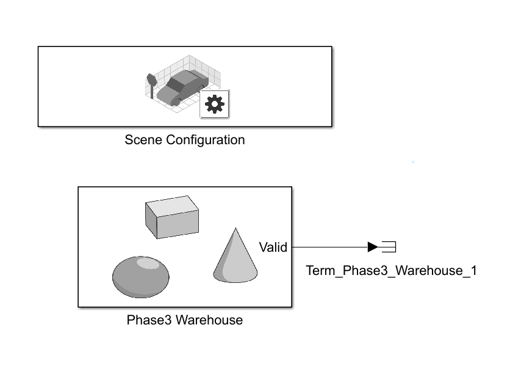</p>

- The `Simulation 3D Scene Configuration` block selects the Unreal Engine scene and the sample time of the co-simulation.
- The `Phase3 Warehouse` actor block creates the static environment: the eight shelves with three levels, the three packing stations, the staging stands, the floor marks, and the six home pads.
- The layout comes from `makePhase3Layout.m`, so a new layout function changes the whole warehouse without changing the model.
- Source: Simulation 3D Scene Configuration and Actor blocks.


**The robot block `Robot Kinova`**

<p align="center"></p>

- This Simulation 3D Robot block places the base and the seven-joint Kinova Gen3 arm in the Unreal Engine scene.
- The block receives the joint configuration and the base transform from the controller and moves the arm accordingly. It reports the ground-truth configuration and a grasp flag back to the model.
- The constants around it set the grasp region and switch the native grasp off, because the project moves the carried box with its own carton driver.
- Source: Block parameters of the Simulation 3D Robot block.


**Parameters of the robot camera block**

<p align="center">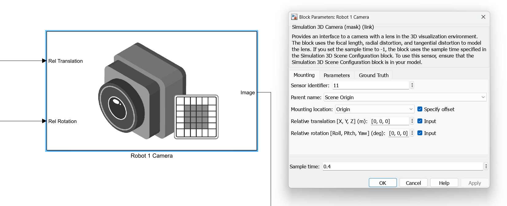</p>

- The Simulation 3D Camera block is mounted on the lift carriage and produces the image of 640 x 480 pixels that the box detector analyses.
- The mounting position and the pitch angle come from the pose of the robot and the lift height, so that the camera looks at the shelf slot in front of the robot.
- The detector `Phase3CamDetect` then applies colour segmentation and silhouette matching with the Computer Vision Toolbox.
- Source: Block parameters of the Simulation 3D Camera block.


**Wiring of the carton pool**

<p align="center">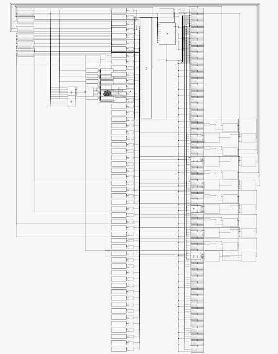</p>

- The warehouse holds 54 boxes, and each box is an actor in the Unreal Engine scene.
- The carton router receives the carried-box state of every robot and sends the translation, the rotation, and a drive flag to the 54 carton drivers.
- While a robot carries a box, its driver moves the box together with the gripper. Otherwise the box stays where it was placed.
- The Transform Get blocks read the poses back, and `Pool Pack` combines all 54 poses into one vector that every robot receives as the input `Pool`.
- Source: Simulink model `WarehouseFleetSim.slx`.


**Carton actor transform block**

<p align="center">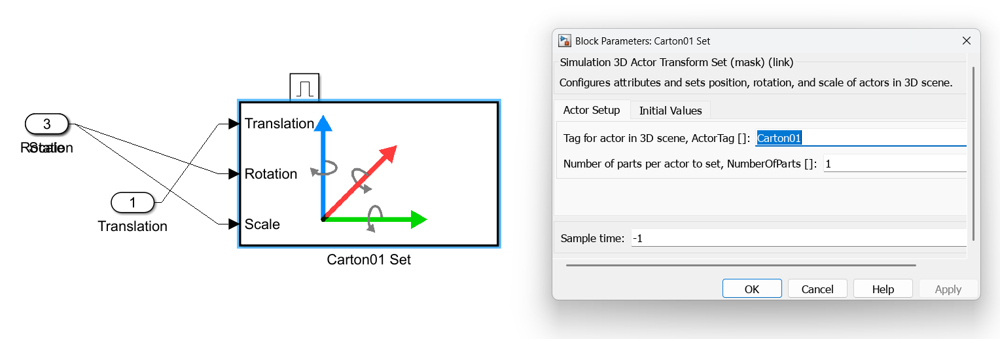</p>

- This `Simulation 3D Actor Transform Set` block sets the position and the orientation of one box actor.
- The block sits inside an enabled subsystem, so the model writes a new pose only while the box is carried or placed. All other boxes keep the pose that the scene already holds.
- Source: Block parameters of the Simulation 3D Actor Transform Set block.


---

## 6. Mathematical model

This section lists the mathematical operations that the project uses. Please find below each equation, the reason why the project needs it and the meaning of its symbols. After each equation, a short worked calculation shows how the numbers go in, how the result is obtained and how often it is evaluated.

### 6.1 Base kinematics

I need this model to move the base of every robot from the wheel speeds that the controller commands. The Differential Drive Kinematic Model block integrates these equations.

$$v=\frac{v_R+v_L}{2},\qquad \omega=\frac{v_R-v_L}{b},\qquad \dot x=v\cos\theta,\quad \dot y=v\sin\theta,\quad \dot\theta=\omega$$

where $v$ is the forward speed of the base, $\omega$ is its turning rate, $v_R$ and $v_L$ are the right and left wheel speeds, $b$ is the distance between the wheels, $(x,y)$ is the position and $\theta$ is the heading. The robot first rotates towards the next waypoint and then drives along it, with a hysteresis on the heading error.

**Calculation**

Example: $v_R=0.6$ m/s, $v_L=0.4$ m/s, $b=0.5$ m, $\theta=0$, time step 0.1 s.

$$\begin{aligned}v&=\frac{0.6+0.4}{2}=0.5\ \text{m/s}\\ \omega&=\frac{0.6-0.4}{0.5}=0.4\ \text{rad/s}\\ \dot x&=0.5\cos 0=0.5\ \text{m/s},\qquad \dot y=0.5\sin 0=0\ \text{m/s}\\ \Delta x&=0.5\cdot 0.1=0.05\ \text{m},\qquad \Delta\theta=0.4\cdot 0.1=0.04\ \text{rad}\end{aligned}$$

*Evaluated in every simulation time step, for every robot.*

**Use of the result:** The new pose (0.05 m ahead and turned by 0.04 rad) goes to the Unreal Engine scene, so the robot moves by this distance in this step.

### 6.2 Odometry and localization

The sensing block creates wheel odometry from the simulated motion and adds noise of 2 % in distance and 2 % in rotation, and a heading drift of 0.01 rad per metre. A real robot also has such errors, so I wanted the localization to work with them.

$$\tilde{\Delta s}=\Delta s\,(1+\varepsilon_s),\qquad \tilde{\Delta\theta}=\Delta\theta\,(1+\varepsilon_\theta)+\varepsilon_d\,\Delta s$$

where $\Delta s$ and $\Delta\theta$ are the true travelled distance and turn, the tilde marks the noisy values and $\varepsilon_s$, $\varepsilon_\theta$ and $\varepsilon_d$ are random noise terms.

**Calculation**

Example: $\Delta s=0.10$ m, $\Delta\theta=0.05$ rad, $\varepsilon_s=+0.02$, $\varepsilon_\theta=-0.02$, $\varepsilon_d=0.01$ rad/m.

$$\begin{aligned}\tilde{\Delta s}&=0.10\,(1+0.02)\\ &=0.102\ \text{m}\\ \tilde{\Delta\theta}&=0.05\,(1-0.02)+0.01\cdot 0.10\\ &=0.049+0.001=0.050\ \text{rad}\end{aligned}$$

*Evaluated in every sensing step. The noise is drawn again each time.*

**Use of the result:** The controller and AMCL take the noisy step (0.102 m, 0.050 rad) as odometry, so the pose estimate drifts like on a real robot until the lidar corrects it.

AMCL then corrects the pose with the lidar scan. Each particle gets a weight from the likelihood of the scan, and the estimate is the weighted mean.

$$w_k\propto p(z\mid x_k,m),\qquad \hat x=\sum_{k=1}^{K} w_k\,x_k$$

where $K$ is the number of particles, $x_k$ is the pose of particle $k$, $w_k$ is its weight, $z$ is the lidar scan, $m$ is the occupancy map and $\hat x$ is the estimated pose.

**Calculation**

Example with three particles at $x=1.00,\ 1.10,\ 0.90$ m and the weights $0.5,\ 0.3,\ 0.2$.

$$\begin{aligned}\hat x&=0.5\cdot 1.00+0.3\cdot 1.10+0.2\cdot 0.90\\ &=0.50+0.33+0.18\\ &=1.01\ \text{m}\end{aligned}$$

*Evaluated with every lidar update. The real filter uses many more particles and the full pose.*

**Use of the result:** The robot takes 1.01 m as its position and plans its next move from there.

Two safeguards protect this estimate. An update is rejected when it jumps more than 1.0 m from the current estimate, and the estimate is reset when the position error $e$ stays above 0.6 m for more than 1 s.

**Calculation**

Example: a new estimate lies 1.2 m from the current one, and the position error is 0.7 m for 1.2 s.

$$\begin{aligned}1.2\ \text{m}&>1.0\ \text{m} &&\Rightarrow\ \text{update rejected}\\ e=0.7\ \text{m}&>0.6\ \text{m}\\ 1.2\ \text{s}&>1\ \text{s} &&\Rightarrow\ \text{estimate reset}\end{aligned}$$

*Evaluated with every localization update.*

**Use of the result:** The 1.2 m jump is ignored and the robot keeps its old pose, and after the 0.7 m error for 1.2 s the estimate is reset, so the robot trusts the corrected pose again.

### 6.3 Route planning

A\* finds the shortest route of one robot on the inflated occupancy map. M\* is needed when the routes of several robots collide, and it minimizes the weighted sum of their route lengths.

$$f(n)=g(n)+h(n)$$

$$\min \sum_{i} w_i L_i \quad\text{subject to}\quad \lVert p_i(t)-p_j(t)\rVert\ge d_{\mathrm{safe}}\quad\text{for all } i\neq j$$

where $n$ is a grid node, $g(n)$ is the cost from the start to $n$, $h(n)$ is the estimated cost from $n$ to the goal, $L_i$ is the route length of robot $i$, $w_i$ is its planning priority, $p_i(t)$ is its position at time $t$ and $d_{\mathrm{safe}}$ is the required safety distance.

**Calculation**

Example: a node with $g(n)=8.0$ m and $h(n)=5.5$ m, and two colliding routes of 20 m and 26 m with equal priorities $w_1=w_2=1$.

$$\begin{aligned}f(n)&=g(n)+h(n)\\ &=8.0+5.5=13.5\ \text{m}\\ \sum_i w_i L_i&=1\cdot 20+1\cdot 26\\ &=46\ \text{m}\end{aligned}$$

*A\* runs when a task is assigned. M\* runs only when the routes of up to three robots collide.*

**Use of the result:** A\* expands the node with the lowest f first, and M\* keeps the 46 m joint plan, so both robots follow these routes.

### 6.4 Safety distance

A robot with a box and an extended arm is larger than its chassis circle. I therefore measure the distance between two robots after subtracting the reach of the box and the arm.

$$d_{ij}=\lVert p_i-p_j\rVert-\rho_i-\rho_j$$

where $d_{ij}$ is the effective distance between robots $i$ and $j$, $p$ is the robot centre and $\rho$ is the reach beyond the chassis circle (0.6 m for a carried box and 0.5 m for the extended arm). A robot slows down at $d_{ij}<r_i+r_j+0.27$ m and stops at $d_{ij}<r_i+r_j+0.12$ m, where $r$ is the chassis radius. The summary of a run counts a near miss below 1.17 m and a collision below 0.90 m.

**Calculation**

Example: the centres of two robots are 2.50 m apart, robot 1 carries a box ($\rho_1=0.6$ m) and robot 2 has its arm extended ($\rho_2=0.5$ m).

$$\begin{aligned}d_{12}&=2.50-0.6-0.5=1.40\ \text{m}\\ 1.40\ \text{m}&>1.17\ \text{m} &&\Rightarrow\ \text{no near miss, no slow-down}\\ d_{12}&=1.90-0.6-0.5=0.80\ \text{m}\\ 0.80\ \text{m}&<0.90\ \text{m} &&\Rightarrow\ \text{collision}\end{aligned}$$

*Evaluated in every control step, for every pair of robots.*

**Use of the result:** At 1.40 m both robots keep driving normally, and at 0.80 m the run counts a collision.

### 6.5 Camera projection

Before a grasp, the camera checks whether the box is really at the expected slot. For this, the expected box position is projected into the camera image.

$$u=f_x\frac{X_c}{Z_c}+c_x,\qquad v=f_y\frac{Y_c}{Z_c}+c_y$$

where $(X_c,Y_c,Z_c)$ is the box position in the camera frame, $f_x$ and $f_y$ are the focal lengths in pixels, $(c_x,c_y)$ is the image centre and $(u,v)$ is the pixel position.

**Calculation**

Example: $f_x=f_y=500$ px, image centre $(320,240)$, box at $(X_c,Y_c,Z_c)=(0.10,\,-0.05,\,1.00)$ m.

$$\begin{aligned}u&=500\cdot\frac{0.10}{1.00}+320=50+320=370\\ v&=500\cdot\frac{-0.05}{1.00}+240=-25+240=215\\ (u,v)&=(370,\ 215)\end{aligned}$$

*The box should appear near pixel (370, 215). The detector accepts a box within 35 cm of the expected position. Evaluated once before each grasp.*

**Use of the result:** The detector looks for the box near pixel (370, 215), and a box within 35 cm of the expected position passes the check, so the robot goes on with the grasp.

### 6.6 Arm inverse kinematics

The arm must bring the gripper to the box or to the shelf slot. The solver searches the joint angles that reach the desired pose within the joint limits.

$$q^*=\arg\min_{q}\ \lVert \mathrm{FK}(q)-T_d\rVert^2\quad\text{subject to}\quad q_{\min}\le q\le q_{\max}$$

where $q$ is the vector of joint angles, $\mathrm{FK}(q)$ is the pose of the gripper for these angles, $T_d$ is the desired pose and $q_{\min}$ and $q_{\max}$ are the joint limits.

**Calculation**

Example: the gripper of a trial solution $q$ is 3 mm away from the desired position.

$$\begin{aligned}\lVert \mathrm{FK}(q)-T_d\rVert&=0.003\ \text{m}\\ \lVert \mathrm{FK}(q)-T_d\rVert^2&=(0.003)^2\\ &=9\cdot 10^{-6}\ \text{m}^2\end{aligned}$$

*The solver repeats this until the value is below its tolerance and every joint is inside its limits. Evaluated whenever the controller needs a new arm target.*

**Use of the result:** If the value is small enough and every joint is inside its limits, the arm moves to this solution, otherwise the arm waits and the task goes to the fault recovery.

### 6.7 Utilization and energy

These figures judge a run. They tell me whether the fleet size fits the workload. The throughput has its own section (6.8).

$$U=\frac{1}{N_r}\sum_{i=1}^{N_r}\frac{t_i}{T_{\mathrm{work}}}$$

where $U$ is the mean utilization, $N_r$ is the number of robots, $t_i$ is the busy time of robot $i$ and $T_{\mathrm{work}}$ is the working time of the run.

**Calculation**

Example: run 20261028_021553, six robots with the ratios $t_i/T_{\mathrm{work}}$ between 0.58 and 0.90.

$$\begin{aligned}U&=\frac{1}{6}\sum_{i=1}^{6}\frac{t_i}{T_{\mathrm{work}}}=0.81\\ \sum_{i=1}^{6}\frac{t_i}{T_{\mathrm{work}}}&=6\cdot 0.81\\ &=4.86\end{aligned}$$

*A value between 55 % and 90 % is rated as suitable. Calculated once at the end of the run.*

**Use of the result:** The value 0.81 is inside the 55 to 90 % band, so the summary says that the fleet size fits the workload.

The energy of a run is the sum of four parts.

$$E=E_{\mathrm{drive}}+E_{\mathrm{lift}}+P_{\mathrm{arm}}\,t_{\mathrm{arm}}+N_r\,P_{\mathrm{base}}\,T$$

where $E_{\mathrm{drive}}$ and $E_{\mathrm{lift}}$ come from the simulated motion, $P_{\mathrm{arm}}=36$ W is the power of the arm while it works, $t_{\mathrm{arm}}$ is the total working time of the arms of all robots, $N_r$ is the number of robots, $P_{\mathrm{base}}=30$ W is the assumed power of the base electronics of one robot and $T$ is the simulated time of the run.

**Calculation**

Example: the same run, $N_r=6$, $T=389$ s, $E_{\mathrm{drive}}=7.0$ Wh, $E_{\mathrm{lift}}=0.45$ Wh, arm part 9.5 Wh.

$$\begin{aligned}N_r P_{\mathrm{base}}T&=6\cdot 30\ \text{W}\cdot 389\ \text{s}=70\,020\ \text{J}\approx 19.4\ \text{Wh}\\ P_{\mathrm{arm}}t_{\mathrm{arm}}&=36\ \text{W}\cdot 950\ \text{s}=34\,200\ \text{J}=9.5\ \text{Wh}\\ E&=7.0+0.45+9.5+19.4\\ &=36.35\ \text{Wh}\approx 36.3\ \text{Wh}\end{aligned}$$

*The summary prints 36.3 Wh. Calculated once at the end of the run.*

**Use of the result:** The total of 36.3 Wh is written into the summary, together with 2.02 Wh per task (36.3 Wh for 18 tasks).

### 6.8 Throughput

The throughput tells how many tasks the fleet finishes in one hour.

$$\text{throughput}=\frac{N}{T}$$

where $N$ is the number of finished tasks and $T$ is the working time of the run in hours.

**Calculation**

Example: the runs 20261026_021735, 20261027_034054 and 20261028_000443.

$$\begin{aligned}\frac{17}{391/3600}&=156.5\ \text{tasks/h}\\ \frac{19}{648/3600}&=105.6\ \text{tasks/h}\\ \frac{6}{328/3600}&=65.9\ \text{tasks/h}\end{aligned}$$

*The summary prints 156.6 for the first run because it uses the unrounded time. Calculated once at the end of every run.*

**Use of the result:** The values are written into the run summary, and the fleet size is judged from them together with the utilization.

<p align="center">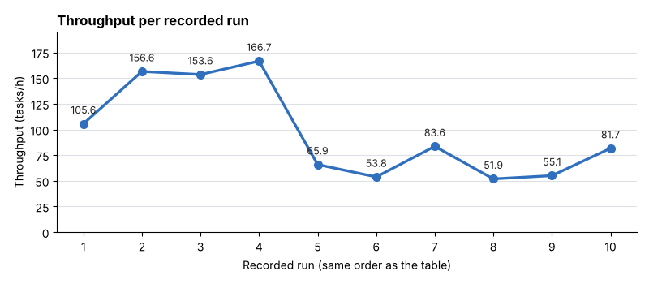</p>

*The graph shows the throughput of the ten recorded runs, in the same order as the table in section 7.2.*

The three long Auto runs (runs 2, 3 and 4) reach 153 to 167 tasks per hour, because the six robots always have a task to work on. The short Manual and Batch runs show lower values of 52 to 84 tasks per hour, because they contain only a few tasks, and the time that the robots need to reach their first task has a large share of the run. Therefore the throughput should be compared between runs of a similar task mix.

---

## 7. Results and output

### 7.1 Demo

The first animation shows the start of an Auto run on the live 2-D map. The six robots leave their home pads at intervals of 10 s and receive their first tasks.

**Start of an Auto run on the live map**

<p align="center">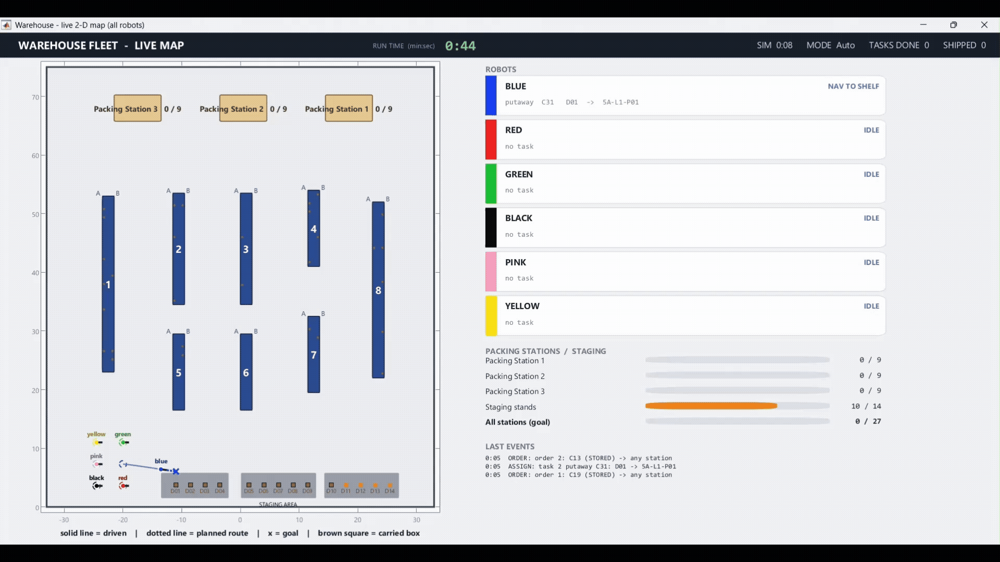</p>

- The six robots leave their home pads at intervals of 10 s and receive their first tasks.
- The animation shows the first assignments, the route planning, and the first shelf visits.
- Source: Live map window, Phase 3, Auto mode (13 MB).


The second animation shows a longer part of the same run. The map displays the driven paths, the planned routes, the carried boxes, the fill level of the stations and the activity of every robot.

**Live 2-D map during an Auto run**

<p align="center">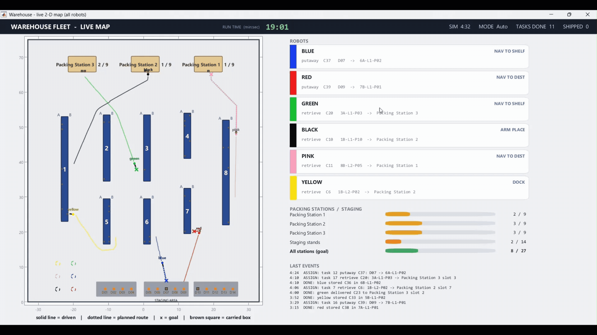</p>

- The map shows the floor plan, the six robots as coloured discs, the driven path as a solid line, and the planned route as a dotted line.
- The side panel lists the activity of every robot, the last events, and the fill level of the stations.
- Source: Live map window, Phase 3, Auto mode.


The next animation shows several robots in the Unreal Engine window at the same time.

**Robots working in the 3-D viewer**

<p align="center">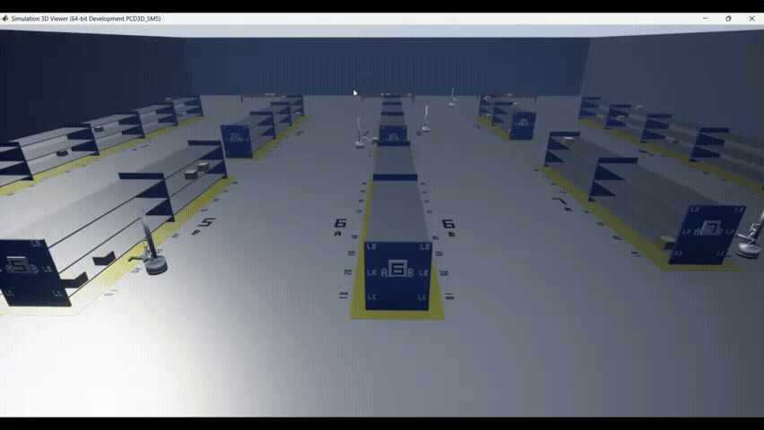</p>

- Several robots dock at shelf faces, handle boxes, and drive to the packing stations at the same time.
- Source: Simulation 3D Viewer (Unreal Engine), Phase 3.


The last animation puts the image of the robot camera next to the 3-D view of the same moment.

**Robot camera and 3-D view side by side**

<p align="center">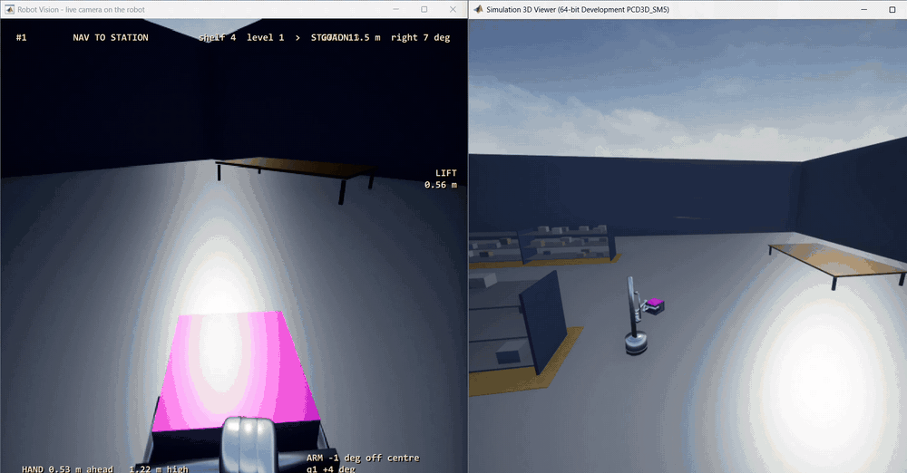</p>

- The left side shows the image of the robot camera on the lift carriage. The right side shows the same moment in the 3-D viewer.
- The comparison shows what the robot sees while it checks a box position.
- Source: Robot camera window and 3-D viewer, recorded together.


### 7.2 Recorded runs

I recorded the runs below on my own laptop with the Unreal Engine scene. Every value is copied from the `Summary_*.txt` file that the program writes after each run.

| Run ID | Robots | Task mix (put-away / retrieve) | Simulated time | Tasks done | Throughput (tasks/h) | Mean utilization | Minimum robot distance | Near misses | Collisions | Camera checks passed |
|---|---|---|---|---|---|---|---|---|---|---|
| 20261027_034054 | 6 | 10 / 9 | 648 s | 19 | 105.6 | 68 % | 1.23 m | 0 | 0 | 15 |
| 20261026_021735 | 6 | 9 / 8 | 391 s | 17 | 156.6 | 74 % | 1.79 m | 0 | 0 | 14 |
| 20261027_233143 | 6 | 10 / 8 | 422 s | 18 | 153.6 | 69 % | 1.23 m | 0 | 0 | 18 |
| 20261028_021553 | 6 | 8 / 10 | 389 s | 18 | 166.7 | 81 % | 1.02 m | 1 | 0 | 3 |
| 20261028_000443 | 6 | 0 / 6 | 328 s | 6 | 65.9 | 64 % | 1.34 m | 0 | 0 | 5 |
| 20261027_045059 | 6 | 0 / 6 | 402 s | 6 | 53.8 | 59 % | 1.25 m | 0 | 0 | 5 |
| 20261027_230622 | 6 | 1 / 3 | 172 s | 4 | 83.6 | 50 % | 1.24 m | 0 | 0 | 1 |
| 20261027_051620 | 6 | 1 / 3 | 277 s | 4 | 51.9 | 36 % | 2.43 m | 0 | 0 | 4 |
| 20261027_053557 | 6 | 3 / 0 | 196 s | 3 | 55.1 | 37 % | 1.88 m | 0 | 0 | 2 |
| 20261028_013901 | 6 | 1 / 3 | 176 s | 4 | 81.7 | 53 % | 0.94 m | 1 | 0 | 1 |

In the three long Auto runs the throughput lies between 153 and 167 tasks per hour, and the summaries rate the fleet size as suitable for this workload. The last run uses `phase3 perf full` with the Unreal Engine lidar.

The run summary lists throughput, utilization, energy, distance, minimum robot distance, near misses, collisions, camera checks and the M\* statistics.

**Run summary, Auto mode, 391 s**

<p align="center">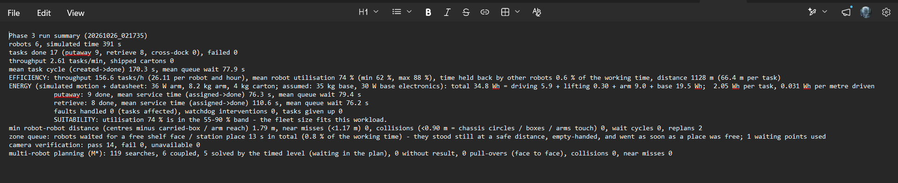</p>

- 17 tasks were completed, with 0 collisions, 0 near misses, and a minimum robot distance of 1.79 m. All 14 camera checks passed.
- Source: `Summary_20261026_021735.txt`.


**Run summary, 157 s**

<p align="center">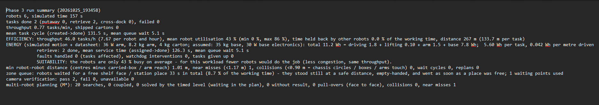</p>

- The summary lists throughput, utilization, energy, and the safety metrics of a shorter run.
- Source: `Summary_*.txt` of the run.


**Run end in the diagnostic viewer**

<p align="center">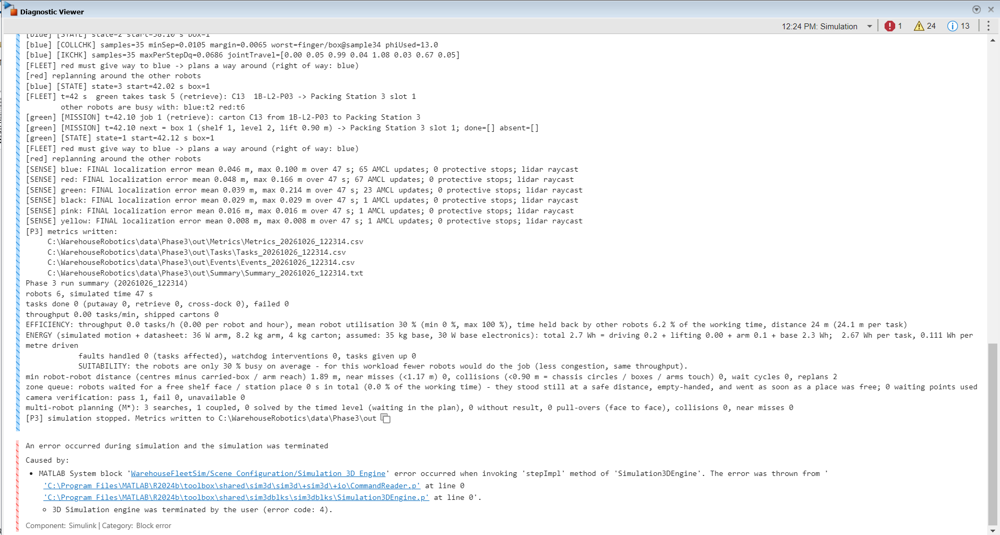</p>

- The viewer prints the key figures of the finished run.
- Source: Diagnostic viewer window.


The task timeline and the per-robot metrics come from the CSV files of the same run.

**Task timeline of an Auto run**

<p align="center">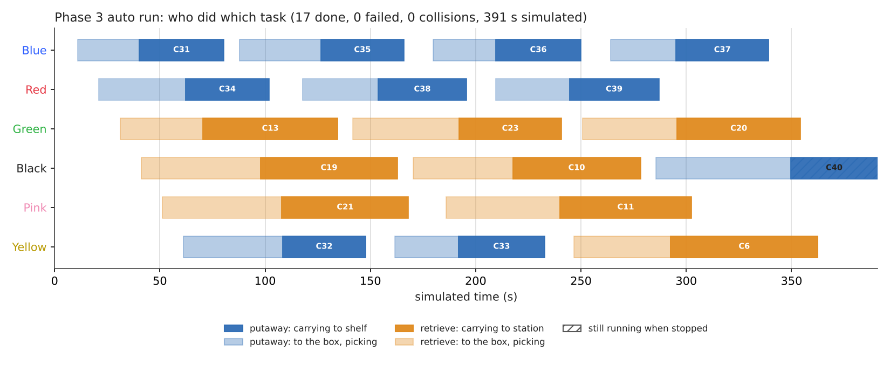</p>

- Each row is one task with its bar from assignment to completion. Light parts show the way to the box, and dark parts show the carrying phase.
- Source: `Tasks_20261026_021735.csv`.


**Utilization and energy per robot**

<p align="center">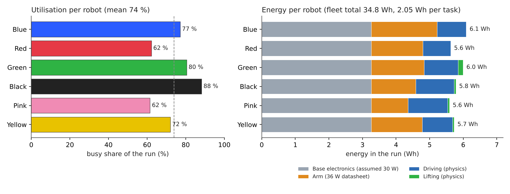</p>

- The chart compares the busy time and the energy use of the six robots.
- Source: `Metrics_20261026_021735.csv`.


The event log records each assignment, pick, delivery and recovery with a time stamp.

**Event log**

<p align="center">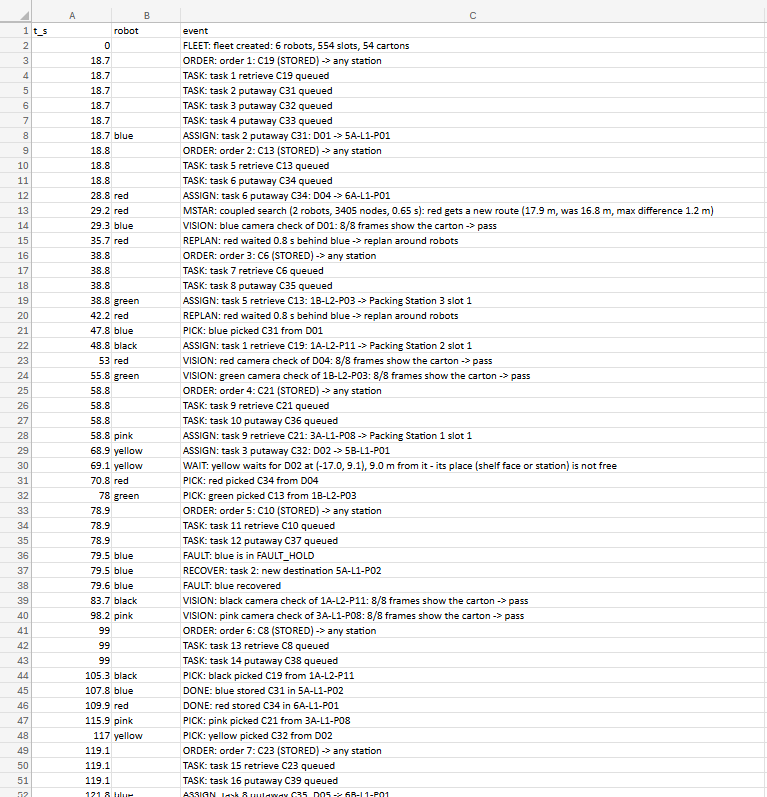</p>

- Each row has a time stamp, the robot, and the event, such as an assignment, a pick, a delivery, or a recovery.
- Source: `Events_*.csv`.


The live map in Manual mode shows six robots that work on shelf 4 together.

**Six robots on shelf 4 in Manual mode**

<p align="center">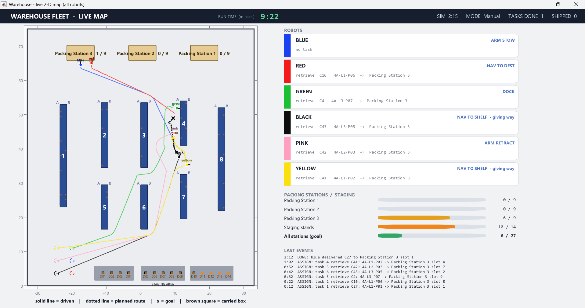</p>

- All six robots receive jobs for the same shelf. The shelf-face capacity rule lets four robots work at once, and the others wait at a safe distance.
- Source: Live map window, Manual mode.


### 7.3 Output files

All files of a run are written to `data\Phase3\out`. The `Summary` folder holds the figures above. The `Tasks` folder holds one row per task with its robot, status and times. The `Events` folder holds the time-stamped log, the `Metrics` folder holds distance, busy time and energy per robot, and the `Logs` folder holds the console log. The folders `Sense`, `Camera` and `Slots` hold the localization error per robot, the saved camera images and the free and occupied slots.

---

## 8. Requirements

- MATLAB R2024b on Windows 10 or 11 (64-bit).
- An NVIDIA graphics card is recommended for the Unreal Engine window, and MATLAB should run on the high-performance GPU. I developed the project on a laptop with 16 GB RAM and an RTX 2050.
- The simulation runs MATLAB, Simulink and the Unreal Engine scene together, so it needs a lot of memory and graphics power. Please run it on a high-end system or laptop. I used a laptop with an RTX 2050, and a better system will run it more smoothly.
- Visual Studio 2022 Professional (version 17.4 or later, 17.6 recommended) for the Unreal Engine editor behind the 3-D window of Simulink 3D Animation. I follow the list of Epic Games for Unreal Engine 5.3. Please select these workloads in the Visual Studio Installer:
  - Workload ".NET desktop development"
  - Workload "Desktop development with C++"
  - Workload ".NET Multi-platform App UI development"
  - Workload "Game development with C++", with the components "C++ profiling tools", "C++ AddressSanitizer", "Windows 10 or 11 SDK (10.0.18362 or newer)" and "Unreal Engine installer"
- These products are used:
  - MATLAB and Simulink
  - Stateflow
  - Simulink 3D Animation (Unreal Engine 5.3.2 scene, camera and actor blocks)
  - Robotics System Toolbox (robot model, inverse kinematics, drive kinematics)
  - Navigation Toolbox (occupancy maps, A\*, `monteCarloLocalization`)
  - Automated Driving Toolbox (`multiObjectTracker`)
  - Computer Vision Toolbox (camera projection and blob analysis)
  - Image Processing Toolbox (required by the Computer Vision Toolbox and the Automated Driving Toolbox)
  - Lidar Toolbox (listed by the MATLAB dependency check of the code)
  - ROS Toolbox (listed by the MATLAB dependency check of the code)
- Please install all these products with the MATLAB Add-On Explorer before the first run. If MATLAB reports a missing product or function later, install that product in the same way.

---

## 9. How to run

1. Download this repository as a ZIP file and extract it. GitHub names the folder `WarehouseRobotics-main`, so please rename it to `WarehouseRobotics` and move it to `C:\WarehouseRobotics`. The code uses this folder as the project root.
2. Start MATLAB R2024b and run these commands.

   ```matlab
   cd C:\WarehouseRobotics\src\Phase3
   addpath(pwd)
   phase3
   ```

3. Wait until the 3-D window and the 2-D map open. Then choose a mode.
4. Type `p3 help` to see all commands. For ready-made task sets (10 sets for Manual mode and 10 sets for Batch mode, from 4 to 18 tasks), copy and paste from [SAMPLE_TASKS.txt](SAMPLE_TASKS.txt).
5. Type `p3 end` to finish a run or `p3 stop` to stop it at once.

The default start uses the light performance mode. The command `phase3 perf full` uses the Unreal Engine lidar and needs a stronger computer. Phase 1 starts with `phase1` in `src\Phase1`, and Phase 2 starts with `phase2` in `src\Phase2`.

### 9.1 Operating modes

In **Manual** mode every command starts at once and runs in parallel with the others. In **Batch** mode I queue jobs for each robot first, and `p3 go` starts all of them together. In **Auto** mode the system puts away arriving boxes and creates retrieve orders by itself, and the run ends after the last task.

### 9.2 Useful commands

- `p3 help` lists all commands.
- `p3 dock add 2` makes two new boxes arrive on free stands.
- `p3 putaway all` lets any free robot put the staging boxes on the shelves.
- `p3 red retrieve 3A-L2-P04 station 1` sends red to bring a box from a slot to Station 1.
- `p3 blue putaway C2 1B-L1-P03` sends blue to put box C2 into a given slot.
- `p3 order any station 1` lets the nearest free robot retrieve any box for Station 1.
- `p3 urgent <slot or box> station 2` creates an emergency job with the highest priority.
- `p3 wms` lists the boxes, the stands, the stations and the free slots.
- `p3 queue` and `p3 go` show and start the Batch queue.
- `p3 end` finishes a run, and `p3 stop` stops it at once.

**The `p3 wms` command**

<p align="center"></p>

- The command lists the boxes on shelves, stands, and stations together with the free slots.
- Source: MATLAB Command Window.


**Start-up log**

<p align="center">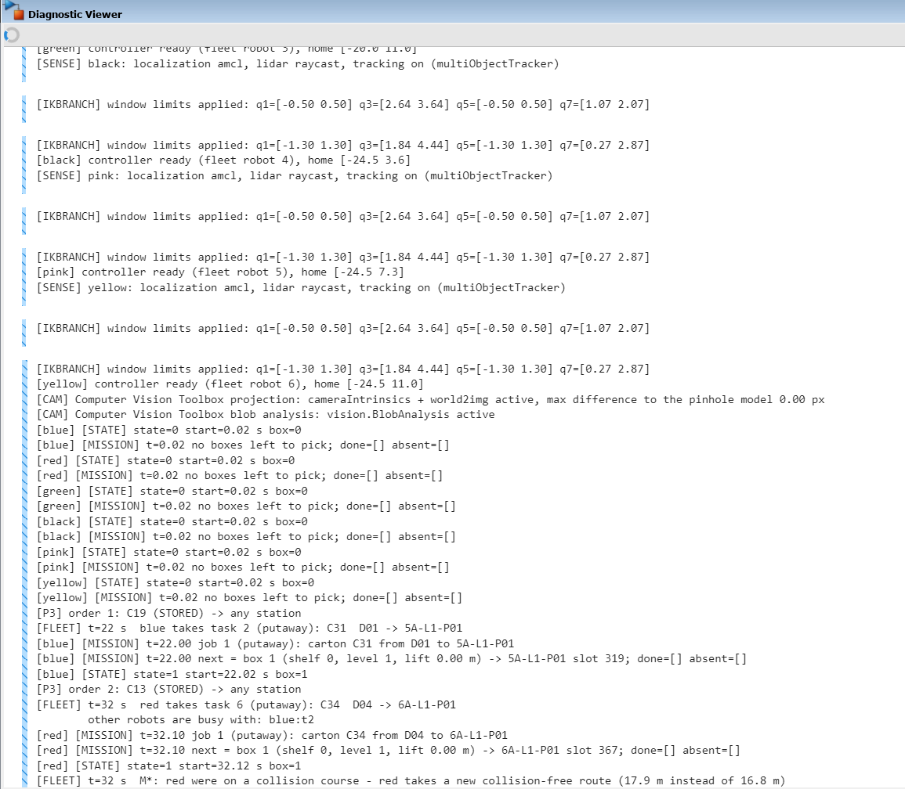</p>

- The log lists the layout, the robots, and the sensing configuration.
- Source: Diagnostic viewer window.


### 9.3 Quick test (about 5 minutes)

1. Start `phase3` and type `p3 mode manual`.
2. Type `p3 red retrieve 4A-L1-P01 station 3`. If this slot is empty in your layout, type `p3 wms` first and use a slot that holds a box.
3. Watch the 2-D map. Red drives to shelf 4, picks the box and delivers it to Packing Station 3.
4. Type `p3 end`. The file `Summary_*.txt` in `data\Phase3\out\Summary` shows `tasks done 1` and `collisions ... 0`.

---

## 10. Design decisions and performance

My laptop cannot handle heavy add-ons at a usable frame rate, so I left several important add-ons out on purpose. The default mode replaces the six Unreal Engine lidar blocks with a ray-cast of the occupancy map. The warehouse holds 54 boxes and no decorative stock, and the gripper is a simple clamp. For this reason the simulation runs slowly on my device. On a computer with a stronger CPU and GPU, and with small changes to the update rates, the same model runs much faster.

Sometimes a robot waits for a while or two robots pass each other closely in the 3-D window. This comes from the compact demonstration warehouse with its narrow aisles. It is not a fault of the robots. With a wider layout, which needs only a new layout function, the robots run without such waits.

I tested the project in two ways. I ran every mode in MATLAB with the Unreal Engine scene and read the summary, task and event files after every run. The folder `tests` also contains `WorldSim.m`, a headless test world that runs the real `Phase3Fleet` code with simulated robots and checks random scenarios for collisions, minimum distance and long stops. It cannot test the arm, the inverse kinematics, AMCL or the Unreal scene, so I checked these parts in MATLAB only.

### Scope and future work

- M\* assumes equal speed for all robots and plans without waiting. The speed layer adds the waiting.
- The reset step of the `perf full` mode uses the simulator pose. A real robot would need global localization.
- The camera measurement can drive the arm target (`C.Sense.CamPlan = 'camera'`). The default uses the exact box position in the robot frame.
- The code uses `C:\WarehouseRobotics` as the project root. The environment variable `P3_ROOT` changes it for Phase 3.
- A real robot would need the ROS Toolbox interface and the vendor API of the Kinova arm.

---

## 11. Use of generative AI

I want to describe openly how I used generative AI in this project, because I believe that it is part of doing this work honestly.

**What I did myself.** The idea of the solution, the plan and the three phases are mine. I read the requirements of Project 212 and decided what the system must do. I chose the methods, which are A\* for single routes, M\* for the joint planning of colliding routes, AMCL for localization, a camera check before every grasp and zone locks for the shelf bays. I also designed the layers of the collision avoidance and decided the safety distances. I wrote the test plan, and I decided when a result was good enough to go to the next step.

**What the tools did.** I used two free tools. Claude wrote most of the code, but always according to my commands, my design and my working. I described what a function must do, which inputs and outputs it has and how it must behave, and Claude wrote the MATLAB code for it. Codex helped me with the environment, which means the setup of the scene and the tools around it. I did not take any code blindly. I asked for changes when the behaviour was not what I wanted. I also used Claude to prepare this README and the block diagram images.

**How I worked.** I worked in small steps. After every change I ran the simulation in MATLAB myself, looked at the 3-D window and the 2-D map, and read the console log, the summary and the CSV files. When something went wrong, for example when the map showed a different route than the 3-D scene, or when a robot shook for a short time, I collected the log files, told the tool what I saw and decided how to solve it. Then I tested again. I repeated this until all modes (Auto, Manual and Batch) ran without a collision.

**What I verified.** I ran every mode on my own laptop with the Unreal Engine scene. All values in the results table come from the summary files of these runs. I also used a headless test world for the fleet logic, and I know exactly which parts it can and cannot test.

**My understanding.** I can explain how the project works, from the task flow and the fleet manager down to the equations in section 6. I can also change the code and run it again.

I follow the Generative AI Guidelines of the MathWorks Challenge Projects, and I sincerely thank MathWorks for these clear guidelines. I am happy to explain any part of my work in more detail.

---

## 12. Repository structure

```
WarehouseRobotics/
├── data/            Layout and run outputs
├── debug/           Diagnostic snapshots
├── docs/            Additional documents
├── media/           Pictures and animations
├── models/          Simulink models
├── robot rec/       Recordings of the robot camera
├── slprj/           Simulink cache (generated)
├── src/
│   ├── Phase1/      Environment
│   ├── Phase2/      One robot
│   └── Phase3/      Six robots
├── tests/           Headless tests of the fleet logic
├── worlds/          World files
├── FULL_PROJECT_README.md
├── LICENSE
├── README.md
└── SAMPLE_TASKS.txt
```

---

## 13. Project video

<p align="center"><a href="https://youtu.be/d-TpP3VBK9M"></a></p>

<p align="center">Click the picture to watch the project video (5 minutes). It gives a short pitch of the project and shows how to run it.</p>

MATLAB and Simulink Challenge Project Hub: [Program](https://github.com/mathworks/MATLAB-Simulink-Challenge-Project-Hub) and [Project description](https://github.com/mathworks/MATLAB-Simulink-Challenge-Project-Hub/tree/main/projects/Warehouse%20Robotics%20Simulation)

`#GlobalStudentChallenge2026`

### References

1. G. Wagner and H. Choset, "Subdimensional expansion for multirobot path planning," *Artificial Intelligence*, vol. 219, pp. 1 to 24, 2015. An earlier version appeared as "M\*: A complete multirobot path planning algorithm with performance bounds," IEEE/RSJ IROS, 2011.
2. MathWorks documentation for Robotics System Toolbox, Navigation Toolbox, Automated Driving Toolbox, Computer Vision Toolbox, Stateflow and Simulink 3D Animation.

---

## 14. Project timeline

The project ran from 16 June 2026 to 5 November 2026.

<p align="center"></p>

---

## 15. Credits

### The Author

I carried out this project as a final-year student.

**Sugavanam M**<br>Department of Electronics and Communication Engineering<br>Mahendra Institute of Technology (Autonomous)<br>Email: ssugan670@gmail.com<br>Namakkal 637 503<br>Tamil Nadu, India

### The Guide

I sincerely thank my guide for her support and guidance throughout this project.

**Dr. Nirmala G**<br>Associate Professor, Department of Electronics and Communication Engineering<br>Mahendra Institute of Technology (Autonomous)<br>Email: nirmalag@mahendratech.org<br>Namakkal 637 503<br>Tamil Nadu, India

I also thank MathWorks for the Challenge Project Hub and for the opportunity to learn through this project.

---

## 16. License

This project is released under the MIT License. See the file [LICENSE](LICENSE).
