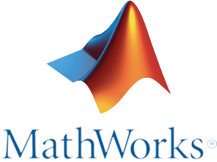

<h1 align="center">Multi-Robot Warehouse Simulation<br>in MATLAB and Simulink</h1>

<br clear="all">

<div align="center">

[](https://www.mathworks.com/products/matlab.html) [](https://www.mathworks.com/products/3d-animation.html) [](https://www.unrealengine.com/) [](https://www.mathworks.com/products/stateflow.html) [](LICENSE)

</div>

**Solution to MATLAB and Simulink Challenge Project 212: Warehouse Robotics Simulation**

I built a warehouse simulation in which six mobile manipulators store and retrieve boxes on their own. A fleet manager assigns the tasks and plans collision free routes with M\*, while every robot localizes itself with lidar and checks each box with a camera. In all recorded runs the robots finished their tasks without a single collision.

---

## 1. Overview

Many warehouses move boxes between a receiving area, the shelves and the packing stations. When several robots share the same narrow aisles, they block each other, reach into the same shelf bay or even collide. I wanted to study this coordination problem in simulation before any real robot is put at risk.

I developed the project in three phases. Phase 1 is the 3-D warehouse. Phase 2 adds one robot that drives to a shelf, docks and grasps a box with a Kinova Gen3 arm. Phase 3 puts six of these robots into the warehouse and adds the fleet manager, the multi-robot planner, the sensing layer and the fault recovery.

Each robot has a differential-drive base, a vertical lift, a seven-joint arm, a camera and a lidar. A Stateflow chart sequences every task, a MATLAB controller drives the base and the arm, and Simulink 3D Animation shows everything in an Unreal Engine scene.

The user works with three modes. Manual and Batch mode let me give jobs by typing short commands, and Auto mode creates the jobs by itself. After every run the program writes a summary with throughput, utilization, energy and the safety figures.

---

## 2. Problem and solution

### Problem

1. E-commerce keeps growing, and customers expect fast delivery. To meet this, warehouses use robots that automate the storage and the retrieval of goods. Simulation is the key to test such scenarios before anything real is built: it shows which algorithms suit the task and what the warehouse design and the robots must be like.

2. This project builds such a simulation as one complete platform. Six mobile manipulators work in a 3-D warehouse, and a fleet manager, a multi-robot planner, a sensing layer and an evaluation of every run are included, so a user can test fleet size, layout and algorithms without risking a real robot.

Such a platform has to solve four technical problems at the same time:

- Every task must go to a suitable robot, so that no robot waits idle while another one is overloaded.
- The routes of all robots must fit together, because two robots with boxes cannot pass each other in a narrow aisle.
- Two arms must never work in the same shelf bay, and two robots must never use the same place of a packing table.
- A robot knows its own position only approximately, but a grasp needs centimetre accuracy.

### Solution

1. The fleet manager `Phase3Fleet` keeps a task queue and a database of 554 slots and 54 boxes. The nearest free robot takes the next task, and an urgent job moves to the front of the queue.
2. Each robot plans its own shortest route with A\*. When the routes of some robots collide, M\* searches only these robots together, so the planning effort stays small.
3. A shelf bay and a station place belong to one robot at a time. The other robots wait with an empty gripper at a safe distance and start as soon as the place is free.
4. Wheel odometry and AMCL give the pose. During the arm motion the robot works relative to the box and the shelf that its camera and lidar measure at close range, so a small localization error does not spoil the grasp.
5. Right of way, a speed layer, a safety bubble and a watchdog are designed to prevent collisions between the robots. They protect the robots in this order, and each layer works on its own.
6. A robot that fails a task folds its arm, gets a new slot or returns the task to the queue, and goes on working.
7. Everything is built as one reusable platform. The Simulink model, the Stateflow task chart and the Unreal Engine scene can be run again with another number of tasks, another task mix or another operating mode.
8. Every run writes its own evaluation metrics (throughput, utilization, energy, minimum robot distance, near misses, collisions and camera checks), so different set-ups can be compared with numbers.

---

## 3. Methodology

I followed the same sequence of steps for every task. The picture shows it from the user command to the log entry, including the path that a fault takes.

<p align="center">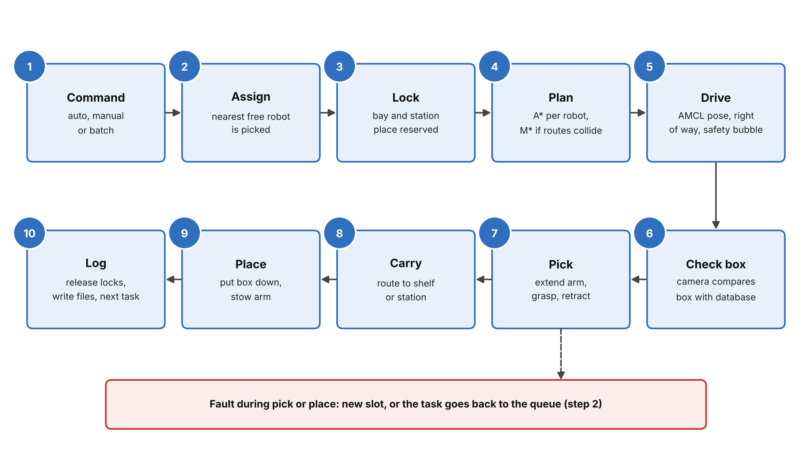</p>

The fleet manager (steps 1 to 4) decides who does the job and by which route. The robot controller (steps 5 to 9) carries it out, and the sensing layer supports steps 5 and 6. A fault in step 7 or 9 does not stop the robot for good, because the recovery logic gives the task a new slot or puts it back into the queue.

I tested each phase before I started the next one. The Phase 2 controller runs without any change in every robot of Phase 3, and this saved a lot of debugging time.

---

## 4. System architecture

The fleet manager sits in the centre. It receives my commands, sends tasks to the six robot controllers and writes the live map and the log files. Each controller exchanges routes with the multi-robot planner and poses with its sensing block. The controllers send joint and base commands to the Simulink model, and the Unreal Engine scene returns the lidar scans and camera images.

<p align="center">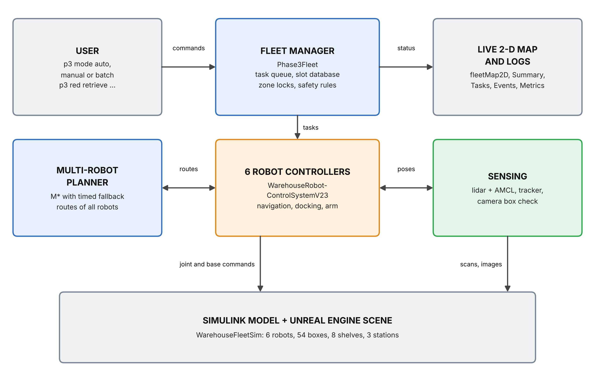</p>

---

## 5. Simulink and Stateflow model

The model `WarehouseFleetSim.slx` has 347 blocks and 78 subsystems at the top level. It has three parts: the fleet level, one robot channel (six copies) and the pool of 54 box actors. The full overview is in [FULL_PROJECT_README.md](FULL_PROJECT_README.md).

**Fleet level and fleet camera.** One MATLAB System block runs the fleet manager with the task queue, the M\* planner, the slots, the zone locks and the metrics. A stop block ends the simulation, and the fleet camera shows one selected robot in a live window.

<p align="center">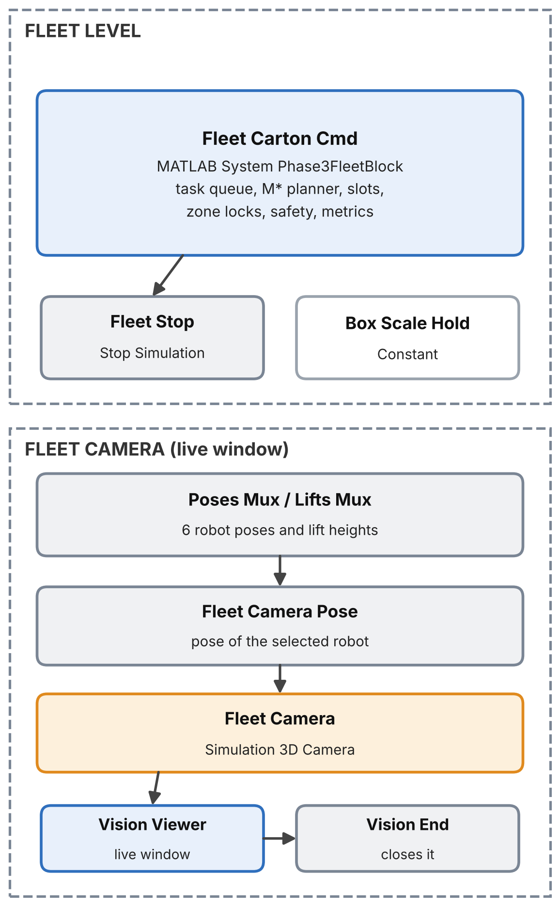</p>

**Robot channel.** Each robot has a sensing block (lidar, wheel odometry, AMCL and tracker), the robot subsystem with the Stateflow chart and the controller, a camera on the lift carriage and a box detector. The block `Differential Drive Kinematics` turns the wheel speeds into the base pose, and `Robot Kinova` shows the base and the arm in the scene.

<p align="center">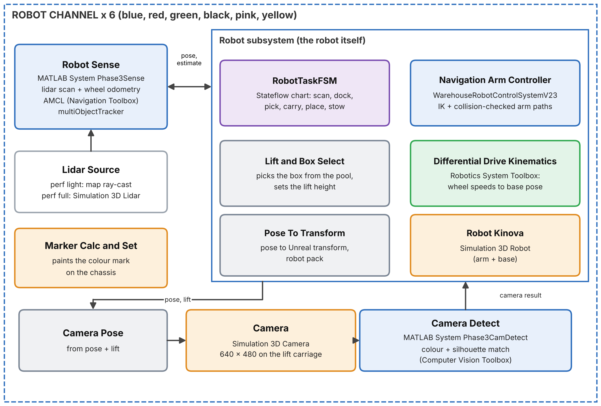</p>

**Carton pool.** The warehouse holds 54 boxes. The carton router turns the carried-box state of the robots into a position and a rotation for each box, so a carried box follows the gripper. The poses are read back and sent to every robot as one vector.

<p align="center">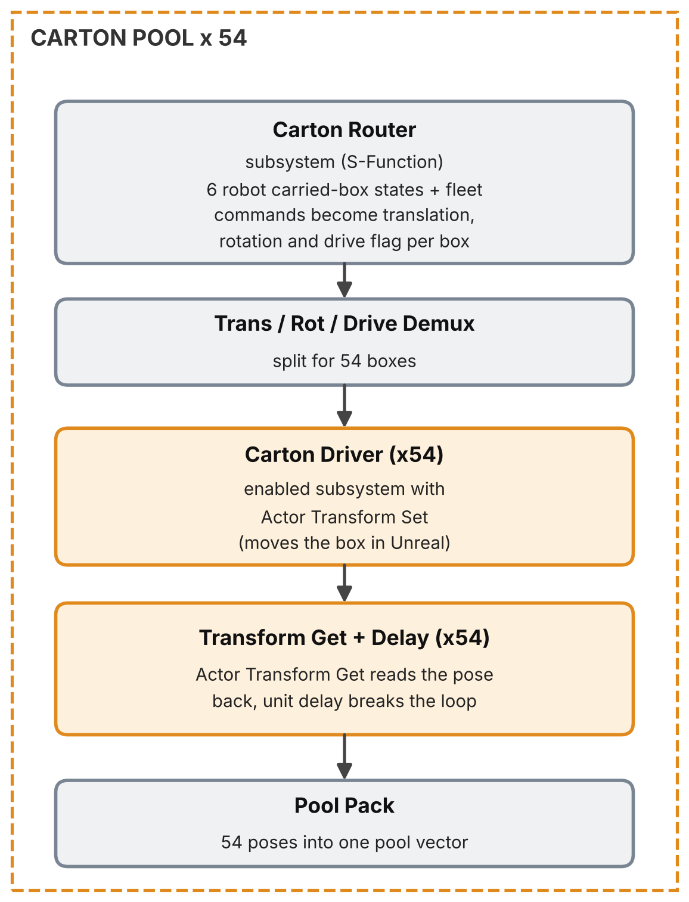</p>

**Stateflow chart.** The chart `RobotTaskFSM` has 13 states. The normal cycle goes through navigation to the shelf, docking, arm extension, grasp, retraction, navigation to the station, placement, release, stowing and return. An arm fault from any working state leads to `FAULT_HOLD`, where the recovery logic takes over.

<p align="center">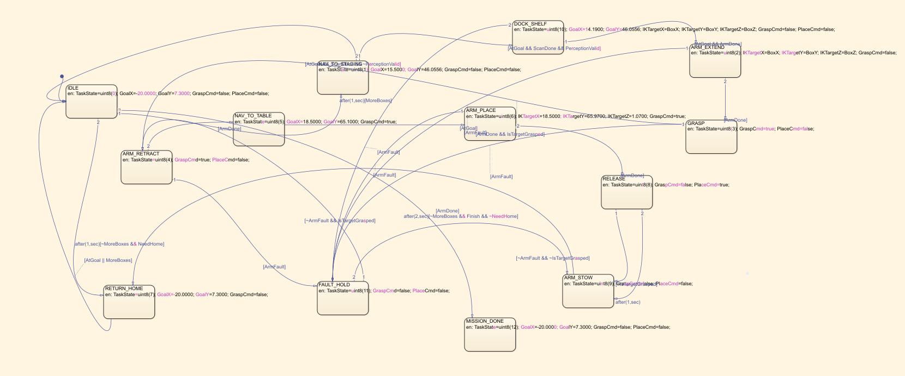</p>

---

## 6. Mathematical model

This section lists the mathematical operations that the project uses. Please find below each equation, the reason why the project needs it and the meaning of its symbols. The calculation steps with numbers are given in [FULL_PROJECT_README.md](FULL_PROJECT_README.md).

### 6.1 Base kinematics

I need this model to move the base of every robot from the wheel speeds that the controller commands. The Differential Drive Kinematic Model block integrates these equations.

$$v=\frac{v_R+v_L}{2},\qquad \omega=\frac{v_R-v_L}{b},\qquad \dot x=v\cos\theta,\quad \dot y=v\sin\theta,\quad \dot\theta=\omega$$

where $v$ is the forward speed of the base, $\omega$ is its turning rate, $v_R$ and $v_L$ are the right and left wheel speeds, $b$ is the distance between the wheels, $(x,y)$ is the position and $\theta$ is the heading.

### 6.2 Localization

The robot only knows an approximate pose from odometry, so AMCL corrects it with the lidar scan. Each particle gets a weight from the likelihood of the scan, and the estimate is the weighted mean.

$$w_k\propto p(z\mid x_k,m),\qquad \hat x=\sum_{k=1}^{K} w_k\,x_k$$

where $K$ is the number of particles, $x_k$ is the pose of particle $k$, $w_k$ is its weight, $z$ is the lidar scan, $m$ is the occupancy map and $\hat x$ is the estimated pose.

Two safeguards protect this estimate. An update is rejected when it jumps more than 1.0 m from the current estimate, and the estimate is reset when the position error $e$ stays above 0.6 m for more than 1 s.

### 6.3 Route planning

A\* finds the shortest route of one robot on the inflated occupancy map. M\* is needed when the routes of several robots collide, and it minimizes the weighted sum of their route lengths.

$$f(n)=g(n)+h(n)$$

$$\min \sum_{i} w_i L_i \quad\text{subject to}\quad \lVert p_i(t)-p_j(t)\rVert\ge d_{\mathrm{safe}}\quad\text{for all } i\neq j$$

where $n$ is a grid node, $g(n)$ is the cost from the start to $n$, $h(n)$ is the estimated cost from $n$ to the goal, $L_i$ is the route length of robot $i$, $w_i$ is its planning priority, $p_i(t)$ is its position at time $t$ and $d_{\mathrm{safe}}$ is the required safety distance.

### 6.4 Safety distance

A robot with a box and an extended arm is larger than its chassis circle. I therefore measure the distance between two robots after subtracting the reach of the box and the arm.

$$d_{ij}=\lVert p_i-p_j\rVert-\rho_i-\rho_j$$

where $d_{ij}$ is the effective distance between robots $i$ and $j$, $p$ is the robot centre and $\rho$ is the reach beyond the chassis circle (0.6 m for a carried box and 0.5 m for the extended arm). A robot slows down at $d_{ij}<r_i+r_j+0.27$ m and stops at $d_{ij}<r_i+r_j+0.12$ m, where $r$ is the chassis radius. The summary of a run counts a near miss below 1.17 m and a collision below 0.90 m.

### 6.5 Camera projection

Before a grasp, the camera checks whether the box is really at the expected slot. For this, the expected box position is projected into the camera image.

$$u=f_x\frac{X_c}{Z_c}+c_x,\qquad v=f_y\frac{Y_c}{Z_c}+c_y$$

where $(X_c,Y_c,Z_c)$ is the box position in the camera frame, $f_x$ and $f_y$ are the focal lengths in pixels, $(c_x,c_y)$ is the image centre and $(u,v)$ is the pixel position.

### 6.6 Arm inverse kinematics

The arm must bring the gripper to the box or to the shelf slot. The solver searches the joint angles that reach the desired pose within the joint limits.

$$q^*=\arg\min_{q}\ \lVert \mathrm{FK}(q)-T_d\rVert^2\quad\text{subject to}\quad q_{\min}\le q\le q_{\max}$$

where $q$ is the vector of joint angles, $\mathrm{FK}(q)$ is the pose of the gripper for these angles, $T_d$ is the desired pose and $q_{\min}$ and $q_{\max}$ are the joint limits.

### 6.7 Performance figures

These figures judge a run. They tell me whether the fleet size fits the workload.

$$\text{throughput}=\frac{N}{T},\qquad U=\frac{1}{N_r}\sum_{i=1}^{N_r}\frac{t_i}{T_{\mathrm{work}}}$$

where $N$ is the number of finished tasks, $T$ is the working time in hours, $U$ is the mean utilization, $N_r$ is the number of robots, $t_i$ is the busy time of robot $i$ and $T_{\mathrm{work}}$ is the working time of the run.

---

## 7. Results and output

### Demo

The animation shows the live 2-D map in Auto mode. Solid lines are the paths that the robots have driven, dotted lines are their planned routes, and the side panel lists the task of every robot.

<p align="center">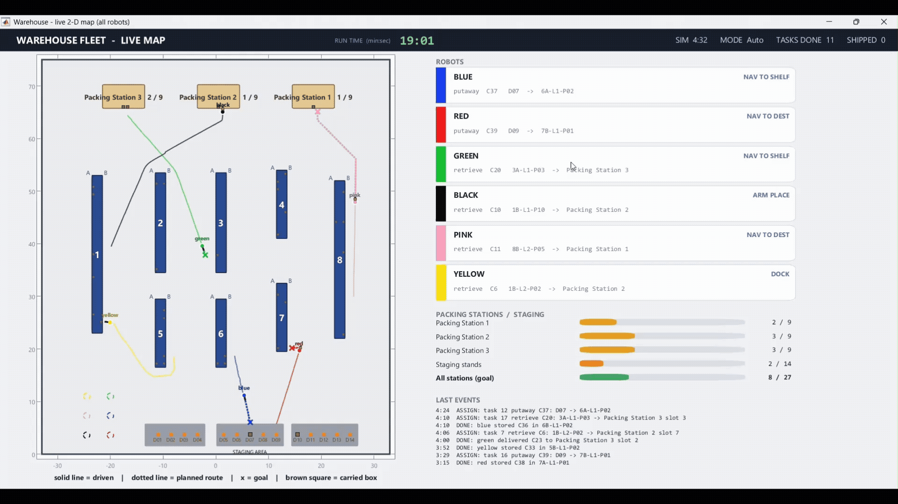</p>

The next animation shows the same warehouse in the Unreal Engine window. The robots dock in front of the shelf slots, extend the arm, grasp the box and carry it to a packing station.

<p align="center">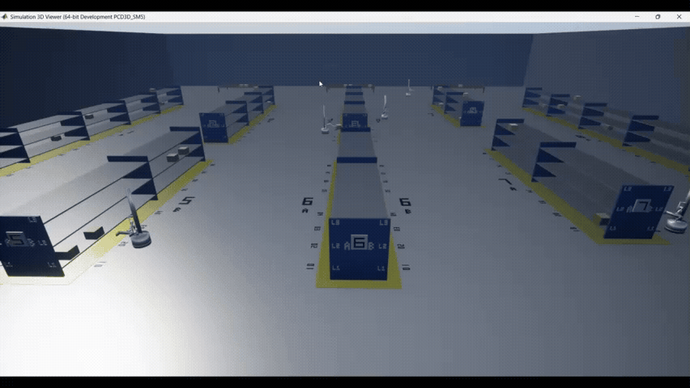</p>

Two robots can work on the same long shelf at the same time. The fleet manager gives each robot its own bay, so the two arms never reach into the same bay.

<p align="center">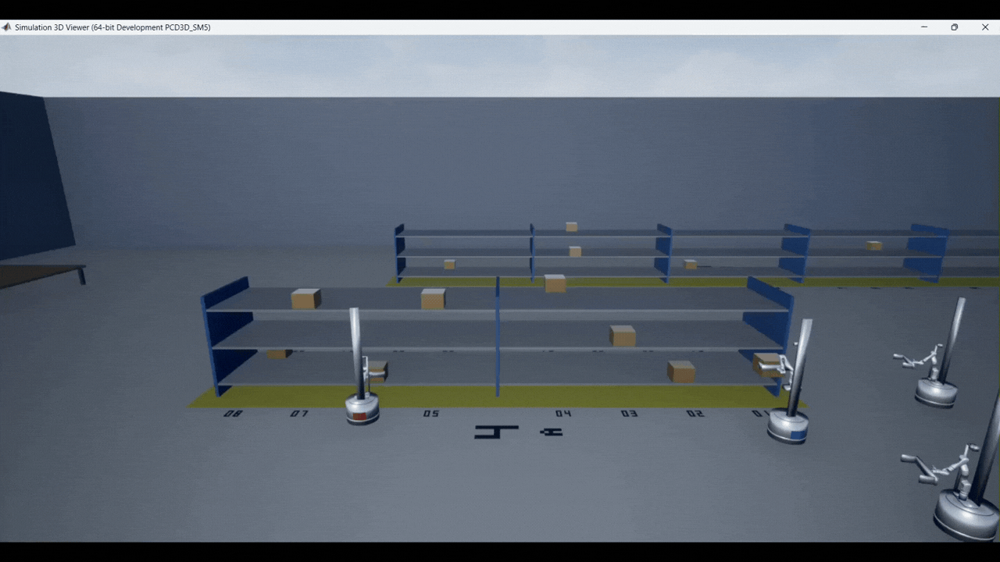</p>

### Recorded runs

I recorded the runs below on my own laptop with the Unreal Engine scene. Every value is copied from the `Summary_*.txt` file that the program writes after each run.

| Run ID | Robots | Task mix (put-away / retrieve) | Simulated time | Tasks done | Throughput (tasks/h) | Mean utilization | Minimum robot distance | Near misses | Collisions | Camera checks passed |
|---|---|---|---|---|---|---|---|---|---|---|
| 20261027_034054 | 6 | 10 / 9 | 648 s | 19 | 105.6 | 68 % | 1.23 m | 0 | 0 | 15 |
| 20261026_021735 | 6 | 9 / 8 | 391 s | 17 | 156.6 | 74 % | 1.79 m | 0 | 0 | 14 |
| 20261027_233143 | 6 | 10 / 8 | 422 s | 18 | 153.6 | 69 % | 1.23 m | 0 | 0 | 18 |
| 20261028_021553 | 6 | 8 / 10 | 389 s | 18 | 166.7 | 81 % | 1.02 m | 1 | 0 | 3 |
| 20261028_000443 | 6 | 0 / 6 | 328 s | 6 | 65.9 | 64 % | 1.34 m | 0 | 0 | 5 |
| 20261027_045059 | 6 | 0 / 6 | 402 s | 6 | 53.8 | 59 % | 1.25 m | 0 | 0 | 5 |
| 20261027_230622 | 6 | 1 / 3 | 172 s | 4 | 83.6 | 50 % | 1.24 m | 0 | 0 | 1 |
| 20261027_051620 | 6 | 1 / 3 | 277 s | 4 | 51.9 | 36 % | 2.43 m | 0 | 0 | 4 |
| 20261027_053557 | 6 | 3 / 0 | 196 s | 3 | 55.1 | 37 % | 1.88 m | 0 | 0 | 2 |
| 20261028_013901 | 6 | 1 / 3 | 176 s | 4 | 81.7 | 53 % | 0.94 m | 1 | 0 | 1 |

The distance in the table is measured between the robot centres after the reach of the box and the arm is subtracted (see section 6.4). The last run uses `phase3 perf full`, which replaces the map ray-cast lidar with the Unreal Engine lidar.

<p align="center">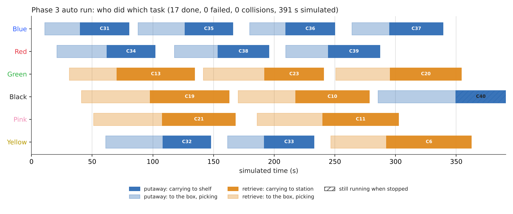</p>

The chart is drawn from `Tasks_20261026_021735.csv`. Each row is one task. The light part of the bar is the drive to the box, and the dark part is the carrying phase.

<p align="center">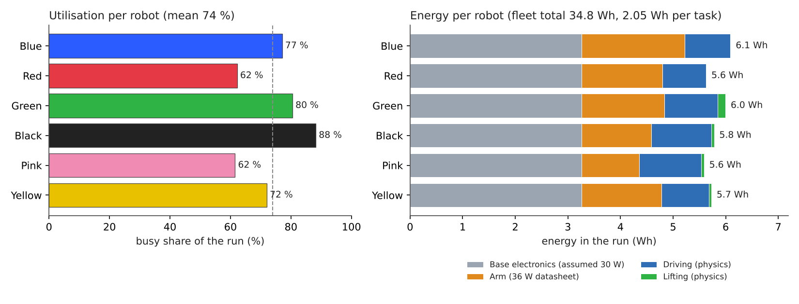</p>

The second chart is drawn from `Metrics_20261026_021735.csv`. It compares the busy time and the energy use of the six robots.

### Output files

Each run writes its files to `data\Phase3\out`. The `Summary` folder holds the figures of the table. The `Tasks` folder holds one row per task with its robot, status and times. The `Events` folder holds a time-stamped log of assignments, picks, deliveries and recoveries. The `Metrics` folder holds the distance, busy time and energy per robot, and the `Logs` folder holds the complete console log.

---

## 8. Requirements

- MATLAB R2024b on Windows 10 or 11 (64-bit).
- An NVIDIA graphics card is recommended for the Unreal Engine window, and MATLAB should run on the high-performance GPU. I developed the project on a laptop with 16 GB RAM and an RTX 2050.
- The simulation runs MATLAB, Simulink and the Unreal Engine scene together, so it needs a lot of memory and graphics power. Please run it on a high-end system or laptop. I used a laptop with an RTX 2050, and a better system will run it more smoothly.
- Visual Studio 2022 Professional (version 17.4 or later, 17.6 recommended) for the Unreal Engine editor behind the 3-D window of Simulink 3D Animation. I follow the list of Epic Games for Unreal Engine 5.3. Please select these workloads in the Visual Studio Installer:
  - Workload ".NET desktop development"
  - Workload "Desktop development with C++"
  - Workload ".NET Multi-platform App UI development"
  - Workload "Game development with C++", with the components "C++ profiling tools", "C++ AddressSanitizer", "Windows 10 or 11 SDK (10.0.18362 or newer)" and "Unreal Engine installer"
- These products are used:
  - MATLAB and Simulink
  - Stateflow
  - Simulink 3D Animation (Unreal Engine 5.3.2 scene, camera and actor blocks)
  - Robotics System Toolbox (robot model, inverse kinematics, drive kinematics)
  - Navigation Toolbox (occupancy maps, A\*, `monteCarloLocalization`)
  - Automated Driving Toolbox (`multiObjectTracker`)
  - Computer Vision Toolbox (camera projection and blob analysis)
  - Image Processing Toolbox (required by the Computer Vision Toolbox and the Automated Driving Toolbox)
  - Lidar Toolbox (listed by the MATLAB dependency check of the code)
  - ROS Toolbox (listed by the MATLAB dependency check of the code)
- Please install all these products with the MATLAB Add-On Explorer before the first run. If MATLAB reports a missing product or function later, install that product in the same way.

---

## 9. How to run

1. Download this repository as a ZIP file and extract it. GitHub names the folder `WarehouseRobotics-main`, so please rename it to `WarehouseRobotics` and move it to `C:\WarehouseRobotics`. The code uses this folder as the project root.
2. Start MATLAB R2024b and run these commands.

   ```matlab
   cd C:\WarehouseRobotics\src\Phase3
   addpath(pwd)
   phase3
   ```

3. Wait until the 3-D window and the 2-D map open. Then choose a mode.
   - `p3 mode auto` creates put-away and retrieve tasks by itself, and the run ends after the last task.
   - `p3 mode manual` lets you type each job, and all jobs run in parallel.
   - `p3 mode batch` lets you queue jobs for each robot, and nothing moves until you type `p3 go`.
4. Type `p3 help` to see all commands. For ready-made task sets (10 sets for Manual mode and 10 sets for Batch mode, from 4 to 18 tasks), copy and paste from [SAMPLE_TASKS.txt](SAMPLE_TASKS.txt).
5. Type `p3 end` to finish a run or `p3 stop` to stop it at once.

The default start uses the light performance mode. The command `phase3 perf full` uses the Unreal Engine lidar and needs a stronger computer. Phase 1 starts with `phase1` in `src\Phase1`, and Phase 2 starts with `phase2` in `src\Phase2`.

### Quick test (about 5 minutes)

1. Start `phase3` and type `p3 mode manual`.
2. Type `p3 red retrieve 4A-L1-P01 station 3`. If this slot is empty in your layout, type `p3 wms` first and use a slot that holds a box.
3. Watch the 2-D map. Red drives to shelf 4, picks the box and delivers it to Packing Station 3.
4. Type `p3 end`. The file `Summary_*.txt` in `data\Phase3\out\Summary` shows `tasks done 1` and `collisions ... 0`.

---

## 10. Design decisions and performance

My laptop cannot handle heavy add-ons at a usable frame rate, so I left several important add-ons out on purpose. The default mode replaces the six Unreal Engine lidar blocks with a ray-cast of the occupancy map. The warehouse holds 54 boxes and no decorative stock, and the gripper is a simple clamp. For this reason the simulation runs slowly on my device. On a computer with a stronger CPU and GPU, and with small changes to the update rates, the same model runs much faster.

Sometimes a robot waits for a while or two robots pass each other closely in the 3-D window. This comes from the compact demonstration warehouse with its narrow aisles. It is not a fault of the robots. With a wider layout, which needs only a new layout function, the robots run without such waits.

---

## 11. Use of generative AI

I planned this project myself. The problem analysis, the system design, the choice of the algorithms, the test procedure and the validation are my own work.

I used two free generative AI tools, Claude and Codex, as coding assistants. Claude wrote code according to my commands, my design and my working, and Codex supported the setup of the environment. I tested every step manually in MATLAB, read every result carefully and decided each next step myself. I can explain every part of this submission. I also used Claude to prepare this README and the block diagram images. I sincerely thank MathWorks for the clear guidelines on the responsible use of AI.

---

## 12. Repository structure

```
WarehouseRobotics/
├── data/            Layout and run outputs
├── debug/           Diagnostic snapshots
├── docs/            Additional documents
├── media/           Pictures and animations
├── models/          Simulink models
├── robot rec/       Recordings of the robot camera
├── slprj/           Simulink cache (generated)
├── src/
│   ├── Phase1/      Environment
│   ├── Phase2/      One robot
│   └── Phase3/      Six robots
├── tests/           Headless tests of the fleet logic
├── worlds/          World files
├── FULL_PROJECT_README.md
├── LICENSE
├── README.md
└── SAMPLE_TASKS.txt
```

---

## 13. Project video

<p align="center"><a href="https://youtu.be/d-TpP3VBK9M"></a></p>

<p align="center">Click the picture to watch the project video (5 minutes). It gives a short pitch of the project and shows how to run it.</p>

MATLAB and Simulink Challenge Project Hub: [Program](https://github.com/mathworks/MATLAB-Simulink-Challenge-Project-Hub) and [Project description](https://github.com/mathworks/MATLAB-Simulink-Challenge-Project-Hub/tree/main/projects/Warehouse%20Robotics%20Simulation)

`#GlobalStudentChallenge2026`

For the complete technical description with all pictures, please read [FULL_PROJECT_README.md](FULL_PROJECT_README.md).

---

## 14. Project timeline

The project ran from 16 June 2026 to 5 November 2026.

<p align="center">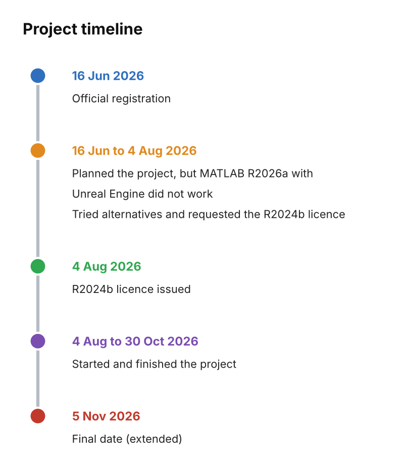</p>

---

## 15. Credits

### The Author

I carried out this project as a final-year student.

**Sugavanam M**<br>Department of Electronics and Communication Engineering<br>Mahendra Institute of Technology (Autonomous)<br>Email: ssugan670@gmail.com<br>Namakkal 637 503<br>Tamil Nadu, India

### The Guide

I sincerely thank my guide for her support and guidance throughout this project.

**Dr. Nirmala G**<br>Associate Professor, Department of Electronics and Communication Engineering<br>Mahendra Institute of Technology (Autonomous)<br>Email: nirmalag@mahendratech.org<br>Namakkal 637 503<br>Tamil Nadu, India

I also thank MathWorks for the Challenge Project Hub and for the opportunity to learn through this project.

---

## 16. License

This project is released under the MIT License. See the file [LICENSE](LICENSE).
